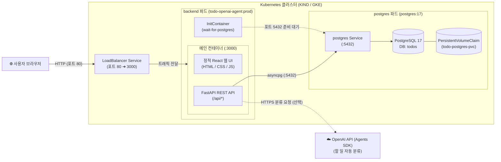
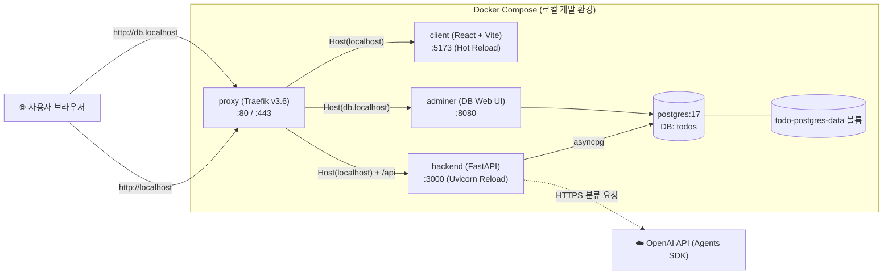

# 시작하기: Todo 앱 (Getting Started Todo App - FastAPI & OpenAI Agents SDK)

이 프로젝트는 최신 클라우드 및 컨테이너 모범 사례를 적용한 할 일(Todo) 목록 애플리케이션입니다. **Python FastAPI** 백엔드와 **React (TypeScript, Vite)** 프론트엔드, **PostgreSQL 17** 데이터베이스, 그리고 Todo 항목 등록 시 작업 유형을 자동 판별하는 **OpenAI Agents SDK** 연동 기능으로 구성되어 있습니다.

Compose 파일부터 멀티스테이지 Dockerfile, Kubernetes 배포, [Katenary](https://github.com/Katenary/katenary) 기반 Helm Chart 변환 및 자동 패치까지 상세히 다룹니다.

## 애플리케이션 아키텍처

### 1) 운영 및 쿠버네티스/Helm 배포 아키텍처

Helm Chart 및 운영 환경에서는 Dockerfile의 멀티스테이지 빌드(`target: final`)를 통해 React 프론트엔드가 정적 HTML/CSS/JS로 컴파일되어 FastAPI 백엔드(`backend/src/static`)에 단일 이미지(`todo-openai-agent:prod`)로 번들링됩니다.



### 2) 로컬 개발 환경 아키텍처 (`compose.yaml`)

개발 중에는 프론트엔드와 백엔드가 서로 다른 핫 리로드(Hot-reload) 도구를 필요로 하므로 별도의 컨테이너로 분리되며, Traefik 프록시가 요청 경로와 도메인에 따라 적절한 서비스로 라우팅합니다.



- **프론트엔드**: React 18, TypeScript, Vite, Bootstrap 5 UI
- **백엔드**: Python FastAPI, Uvicorn, Pydantic, OpenAI Agents SDK + OpenAI API (작업 자동 분류·일정 브리핑)
- **데이터베이스**: PostgreSQL 17 (개발: SQLite/PostgreSQL 지원, 프로덕션: PostgreSQL 17 볼륨 마운트)
- **프로덕션 번들링**: Dockerfile의 멀티스테이지 빌드(`target: final`)를 통해 React 프론트엔드가 정적 파일로 컴파일되어 FastAPI 백엔드(`backend/src/static`)에 번들링되므로 프로덕션에서는 단일 컨테이너(`todo-openai-agent:prod`)로 서비스됩니다.

개발 중에는 백엔드와 프론트엔드에 서로 다른 개발 도구가 필요하므로 두 개의 별도 서비스로 분리되어 있습니다. 이를 통해 [Vite](https://vitejs.dev/)가 React 앱을 핫 리로드하는 동안 [Uvicorn](https://www.uvicorn.org/)이 FastAPI 백엔드의 변경 사항을 실시간 반영(watch)합니다.

## 개발 환경 실행

프로젝트를 실행하려면 Docker Desktop을 설치한 후 다음 명령어들을 실행하기만 하면 됩니다:

```bash
docker compose up --watch
```

웹 브라우저에서 [http://localhost](http://localhost)를 열면 애플리케이션이 정상 실행 중인 것을 바로 확인할 수 있습니다!
백엔드나 프론트엔드에 적용한 모든 변경 사항은 컨테이너를 다시 빌드하거나 재시작할 필요 없이 즉시 반영됩니다.

데이터베이스 관리를 돕기 위해 개발 스택에는 **Adminer**도 포함되어 있으며, [http://db.localhost](http://db.localhost)로 접속할 수 있습니다(대부분의 웹 브라우저는 `*.localhost`를 올바르게 해석하므로 hosts 파일 수정이 필요 없습니다).

### 개발 환경 종료 (Tearing it down)

작업을 마친 후에는 다음 명령어를 실행하여 컨테이너들을 정리하고 종료합니다:

```bash
docker compose down
```

---

## Kubernetes & Helm Chart (Katenary 기반 개발 및 배포)

이 프로젝트는 [Katenary](https://github.com/Katenary/katenary) 도구를 활용하여 환경별 Docker Compose 설정을 쿠버네티스용 **Helm Chart**로 자동 변환하고 배포할 수 있습니다. (Katenary 상세 사용법 및 라벨 레퍼런스는 [Katenary-README-KR.md](Katenary-README-KR.md) 참조)

### 📌 환경별 프로젝트 구성 요약

| 환경 (Environment) | 소스 Compose 파일 | 생성된 Helm Chart 폴더 | 대상 클러스터 및 이미지 | 배포 가이드 |
|---|---|---|---|---|
| **로컬 KIND (Local)** | `compose-prod-build.yml` | `charts/getting-started-todo-app-openai-agent.local_kind` | 로컬 KIND (`todo-openai-agent:prod`) | 본 문서 4절 · [차트 README](charts/getting-started-todo-app-openai-agent.local_kind/README.md) |
| **GitHub Packages (GHCR)** | `compose-prod-GitHub.yml` | `charts/getting-started-todo-app-openai-agent.github_kind` | KIND / 원격 GHCR (`ghcr.io/...`) | 본 문서 7절 · [차트 README](charts/getting-started-todo-app-openai-agent.github_kind/README.md) |
| **GCP Artifact Registry / GKE** | `compose-prod-GCPRegistry.yml` | `charts/getting-started-todo-app-openai-agent.gcp_gke` | GKE / GCP Artifact Registry (`asia-northeast3-docker.pkg.dev/...`) | 본 문서 8절 · [차트 README](charts/getting-started-todo-app-openai-agent.gcp_gke/README.md) |

```text
+------------------------------------+        katenary convert        +-----------------------------------------------+
|  환경별 Docker Compose 파일        |  ===========================>  |  charts/                                      |
|  - compose-prod-build.yml (로컬)   |                                |  ├── getting-started-todo-app-openai-agent.local_kind      |
|  - compose-prod-GitHub.yml (GHCR)  |                                |  ├── getting-started-todo-app-openai-agent.github_kind     |
|  - compose-prod-GCPRegistry.yml    |                                |  └── getting-started-todo-app-openai-agent.gcp_gke         |
+------------------------------------+                                +-----------------------------------------------+
                                                                              ||
                                                                              || helm install / upgrade
                                                                              \/
                                                              +-----------------------------------------------+
                                                              |  Kubernetes (KIND / GKE 클러스터)             |
                                                              |  - backend (Pod / Service)                    |
                                                              |  - postgres (Pod / SVC / PVC)                 |
                                                              +-----------------------------------------------+
```

---

### 1. 사전 준비 (Prerequisites)

1. **Katenary 설치 및 경로 설정 (Windows)**:
   - 프로젝트 루트 디렉터리에 `katenary.exe`가 포함되어 있거나, 설치 디렉터리(예: `C:\Users\<USER>\AppData\Local\Katenary`)를 시스템 환경 변수 `Path`에 추가합니다.
   - 현재 열려 있는 터미널에서 즉시 적용할 경우:
     - **PowerShell**:
       ```powershell
       $env:Path += ";$env:LOCALAPPDATA\Katenary"
       katenary version
       ```
     - **Git Bash**:
       ```bash
       export PATH="$PATH:/c/Users/$USER/AppData/Local/Katenary"
       katenary version
       ```

2. **Compose 파일 내 백엔드 및 서비스 상세 설정 (핵심 분석)**:

   `compose-prod-build.yml`에서 Katenary 변환 및 쿠버네티스 운영을 위해 적용된 핵심 설정 내역입니다:

   ```yaml
   services:
     # 1) 로컬 개발용 프록시: 쿠버네티스 변환 제외
     proxy:
       image: traefik:v3.6
       command:
         - "--providers.docker=true"
         - "--entrypoints.web.address=:80"
         - "--entrypoints.websecure.address=:443"
       ports:
         - 80:80
         - 443:443
       volumes:
         - /var/run/docker.sock:/var/run/docker.sock
       labels:
         katenary.v3/ignore: "true"   # Katenary 변환 시 차트 생성 제외

     # 2) 백엔드 프로덕션 서비스: 프론트엔드 번들 + FastAPI
     backend:
       image: todo-openai-agent:prod        # 빌드 및 쿠버네티스 로드 시 사용할 이미지 태그
       build:
         context: ./
         target: final                # React 프론트엔드 정적 빌드와 FastAPI가 번들링된 최종 스테이지
       ports:
         - 3000:3000                  # 쿠버네티스 Service 생성을 위한 필수 포트 선언
       expose:
         - 3000
       environment:
         POSTGRES_HOST: postgres      # 로컬 Compose 통신용 기본 DB 호스트명
         POSTGRES_USER: postgres
         POSTGRES_PASSWORD: secret
         POSTGRES_DB: todos
         OPENAI_API_KEY: ${OPENAI_API_KEY:-}
       depends_on:
         postgres:
           condition: service_healthy # Katenary가 이를 분석하여 wait-for-postgres InitContainer 자동 구성
       labels:
         # [Katenary 환경변수 동적 매핑]
         # 쿠버네티스에서는 Helm 릴리스명에 따라 PostgreSQL 서비스명이 동적으로 결정되므로
         # ConfigMap 내 POSTGRES_HOST 값을 Helm 템플릿 문법으로 치환하여 서비스 간 DNS 통신을 보장합니다.
         katenary.v3/map-env: |-
           POSTGRES_HOST: '{{ include "__APP__.fullname" . }}-postgres'

         # [Docker Compose 로컬 전용 Traefik 라우팅 라벨]
         # Katenary 변환 시에는 무시되며, 로컬 docker compose up 실행 시 HTTP(80)/HTTPS(443) 프록시 라우팅을 지원합니다.
         traefik.enable: "true"
         traefik.http.routers.backend-http.entrypoints: "web"
         traefik.http.routers.backend-http.rule: "PathPrefix(`/`)"
         traefik.http.routers.backend-http.service: "backend-service"
         traefik.http.routers.backend-https.entrypoints: "websecure"
         traefik.http.routers.backend-https.rule: "PathPrefix(`/`)"
         traefik.http.routers.backend-https.tls: "true"
         traefik.http.routers.backend-https.service: "backend-service"
         traefik.http.services.backend-service.loadbalancer.server.port: "3000"

     # 3) PostgreSQL 데이터베이스 서비스
     postgres:
       image: postgres:17
       ports:
         - 5432:5432
       expose:
         - 5432
       volumes:
         - todo-postgres-data:/var/lib/postgresql/data
       environment: 
         POSTGRES_PASSWORD: secret
         POSTGRES_DB: todos
       healthcheck:
         test: ["CMD-SHELL", "pg_isready -U postgres -d todos"]
         interval: 5s
         timeout: 5s
         retries: 5
   ```

   #### 🔍 설정 세부 해설:
   - **`target: final` & `image: todo-openai-agent:prod`**:
     - `Dockerfile`의 멀티스테이지 빌드를 통해 React 빌드 산출물(`dist`)을 FastAPI 백엔드의 정적 경로(`backend/src/static`)로 복사한 단일 프로덕션 이미지입니다.
     - `image:` 속성을 명시하여 `kind load docker-image todo-openai-agent:prod --name my-k8s` 시 일치하는 태그로 원활하게 클러스터에 주입할 수 있습니다.
   - **`ports` / `expose: 3000` (쿠버네티스 Service 생성)**:
     - Katenary는 Compose 서비스에 명시적인 포트가 정의되어 있지 않으면 쿠버네티스 `Service` 매니페스트를 생성하지 않습니다.
     - `ports: - 3000:3000` 선언을 통해 Helm 변환 시 `templates/backend/service.yaml`(Katenary 기본: ClusterIP, port 3000 → `patch-service-type.py` 적용 후: LoadBalancer, port 80→3000)이 정상 생성되어 외부 포트포워딩 및 파드 간 연결이 가능해집니다.
   - **`katenary.v3/map-env` (쿠버네티스 서비스 DNS 동적 바인딩)**:
     - Docker Compose 환경에서는 `POSTGRES_HOST: postgres`로 통신하지만, 쿠버네티스에서는 Helm 릴리스 이름에 따라 PostgreSQL 서비스의 실제 FQDN이 `<ReleaseName>-getting-started-todo-app-openai-agent-postgres` 형태로 지정됩니다.
     - `map-env` 라벨을 적용하면 Katenary가 생성하는 `backend` ConfigMap 내 `POSTGRES_HOST` 값이 Helm 템플릿(`'{{ include "<chart>.fullname" . }}-postgres'`)으로 변환되어 DB 연결 실패를 완벽히 예방합니다.
   - **`depends_on` 과 InitContainer**:
     - `postgres` 서비스의 `condition: service_healthy` 의존성을 인식하여, Katenary가 백엔드 Deployment 템플릿에 `busybox` 기반의 `wait-for-postgres` InitContainer를 자동 생성합니다. 이를 통해 PostgreSQL 포트(5432)가 정상 응답할 때까지 대기 후 백엔드 메인 컨테이너가 안전하게 기동됩니다.
   - **`katenary.v3/ignore: "true"` (`proxy` 배포 제외)**:
     - 로컬 개발 시에는 프론트엔드 Vite 서버와 백엔드 API를 묶어주기 위해 Traefik 프록시가 필요했지만, 프로덕션에서는 백엔드가 단독으로 프론트엔드를 서빙합니다.
     - 또한 Traefik의 도커 소켓(`/var/run/docker.sock`)은 일반 쿠버네티스 파드에 마운트할 수 없으므로, `ignore` 라벨을 붙여 불필요한 매니페스트 생성을 방지합니다.

---

### 2. Helm 차트 생성 (Katenary Convert)

아래 명령어를 실행하여 로컬용 Docker Compose 설정을 Helm 차트로 변환합니다:

```bash
python scripts/generate-chart.py local_kind
```

- **대상**: `local_kind`, `github_kind`, `gcp_gke`, `all`(기본값, 3개 일괄 생성)
- **옵션**: `-a 1.0.0`은 `Chart.yaml`의 `appVersion`, `-v 0.1.0`은 `version`이며 둘 다 생략 가능합니다.
- **스크립트가 하는 일**:
  1. 임시 폴더 `getting-started-todo-app-openai-agent/`에 소스 Compose 파일을 `compose.yaml`로 복사합니다. (차트 이름은 폴더 이름으로 정해집니다.)
  2. 그 폴더에서 `katenary convert -o <차트 경로> -a <appVersion> -v <version> -i <아이콘 URL> -f`를 실행합니다.
  3. `scripts/patch-service-type.py`로 backend Service를 `LoadBalancer`, 포트 80→3000으로 패치합니다.

> [!IMPORTANT]
> 프로젝트 루트에서 `katenary convert -c compose-prod-build.yml ...`를 직접 실행하지 마세요. `katenary.exe`는 `-c` 값과 관계없이 현재 폴더의 `compose.yaml`을 기본 파일로 읽으려 합니다. 프로젝트 루트의 `compose.yaml`은 개발용(`develop: watch` 포함)이므로 변환 시 오류가 발생할 수 있습니다. 반드시 제공되는 `scripts/generate-chart.py`를 통해 안전하게 변환하세요.

#### 생성되는 차트 디렉터리 구조:
```text
charts/getting-started-todo-app-openai-agent.local_kind/
├── Chart.yaml              # 차트 메타데이터 (이름, 버전, appVersion)
├── README.md               # Katenary가 생성한 차트 안내 문서
├── values.yaml             # 서비스별 기본 구성 값 (레플리카, 이미지 등)
└── templates/              # 쿠버네티스 리소스 매니페스트 템플릿
    ├── NOTES.txt           # 설치 후 출력되는 안내 메시지
    ├── _helpers.tpl        # 네이밍 헬퍼 템플릿
    ├── backend/            # FastAPI + React 번들 서비스 (Deployment, Service, ConfigMap)
    └── postgres/           # PostgreSQL DB (Deployment, Service, PVC, ConfigMap)
```

---

### 3. 차트 검증 및 시뮬레이션 (Helm Lint & Dry-Run)

실제 클러스터에 배포하기 전에 차트의 정적 문법, 메타데이터 사양, 값 바인딩 및 렌더링 결과를 체계적으로 검증합니다.

#### 1) Helm Lint 정적 문법 및 구조 검증 (`helm lint`)

`helm lint`는 생성된 Helm 차트가 쿠버네티스/Helm 모범 사례(Best Practices)와 사양을 준수하는지 정적으로 검사하는 도구입니다. 배포 실패를 유발할 수 있는 다음 항목들을 사전에 감지합니다:
- **`Chart.yaml` 사양 검사**: 필수 필드(`name`, `version`, `apiVersion` 등) 누락 여부 및 형식 오류
- **`values.yaml` 구문 분석**: YAML 문법 오류(Indentation, 괄호 등) 및 기본값 누락 여부
- **`templates/` Go 템플릿 문법 검사**: 잘못된 함수 호출, 변수 참조 오류, 닫히지 않은 제어문
- **네이밍 헬퍼 검증**: `_helpers.tpl`에 정의된 템플릿 함수 호출의 일관성

##### [검증 명령어]

환경별 차트 또는 전체 차트를 대상으로 검사를 실행합니다:

```bash
# 1. 로컬 KIND 환경 차트 검증
helm lint charts/getting-started-todo-app-openai-agent.local_kind

# 2. GitHub Packages (GHCR) 원격 이미지 차트 검증
helm lint charts/getting-started-todo-app-openai-agent.github_kind

# 3. GCP Artifact Registry / GKE 차트 검증
helm lint charts/getting-started-todo-app-openai-agent.gcp_gke

# 4. 전체 환경 차트 일괄 검증 (PowerShell)
Get-ChildItem -Directory charts | ForEach-Object { helm lint $_.FullName }
```

##### [검증 결과 분석 및 통과 기준]

정상적으로 검증을 통과하면 다음과 같이 `0 chart(s) failed` 메시지가 출력됩니다:

```text
==> Linting charts/getting-started-todo-app-openai-agent.local_kind
1 chart(s) linted, 0 chart(s) failed

==> Linting charts/getting-started-todo-app-openai-agent.github_kind
1 chart(s) linted, 0 chart(s) failed

==> Linting charts/getting-started-todo-app-openai-agent.gcp_gke
1 chart(s) linted, 0 chart(s) failed
```

> [!NOTE]
> **`[INFO] Chart.yaml: icon is recommended` 알림 관련 참고 사항**:
> - Helm Lint 실행 시 `[INFO] Chart.yaml: icon is recommended` 알림이 출력될 수 있습니다.
> - 이는 실패(Error)가 아니며, 아티팩트 허브(Artifact Hub) 등 차트 레포지토리에 등록할 때 시각적 아이콘 추가를 권장한다는 안내(INFO)입니다.
> - 본 프로젝트의 차트에는 공식 앱 아이콘 URL(`icon: https://raw.githubusercontent.com/docker/getting-started-todo-app/master/client/public/favicon.ico`)이 기본 등록되어 있어 경고나 안내 없이 깔끔하게 100% 검증을 통과합니다.

#### 2) 렌더링된 매니페스트 확인 (Template)

실제 쿠버네티스 리소스로 렌더링되는 최종 YAML 매니페스트를 로컬에서 즉시 확인합니다:

```bash
helm template todo-app charts/getting-started-todo-app-openai-agent.local_kind
```

#### 3) 클러스터 가상 배포 시뮬레이션 (Dry-Run)

쿠버네티스 API 서버에 실제로 리소스를 생성하지 않고, 배포가 유효하게 수락되는지 서버 측 가상 시뮬레이션을 수행합니다:

```bash
helm install todo-app charts/getting-started-todo-app-openai-agent.local_kind --dry-run=server
```

---

### 4. KIND 클러스터에 배포 (Install)

로컬 Kubernetes(KIND) 클러스터에 애플리케이션을 배포합니다. 프로젝트 루트의 `kind-config-2workers.yaml`을 사용하여 Control-Plane 1대와 Worker 노드 2대로 구성된 `my-k8s` 클러스터를 준비합니다:

```bash
# KIND 클러스터 생성 (Worker 노드 2개 구성)
kind create cluster --name my-k8s --config kind-config-2workers.yaml

# 클러스터 노드 확인
kubectl get nodes
```

1. **로컬 이미지 빌드 및 KIND 클러스터로 로드**:
   - `backend` 서비스는 프로덕션 타깃(`final`) 이미지를 사용합니다:
     ```bash
     # 1. 프로덕션 이미지 빌드 (FastAPI + React 번들)
     docker build -t todo-openai-agent:prod --target final .

     # 2. KIND 클러스터(my-k8s)로 이미지 전달
     kind load docker-image todo-openai-agent:prod --name my-k8s
     ```

2. **Helm 차트 배포 실행**:

   기본 설정값(`values.yaml`)을 그대로 사용하는 방식과, 설정값을 추출하여 사용자 정의 설정(`my-local_kind-values.yaml`)을 적용하는 방식 중 선택하여 배포할 수 있습니다:

   - **방법 A. 기본 설정값으로 즉시 배포**:
     ```bash
     helm install todo-app charts/getting-started-todo-app-openai-agent.local_kind
     ```

   - **방법 B. 설정값 추출 후 사용자 정의 배포 (`my-local_kind-values.yaml`)**:
     차트의 기본 설정값을 파일로 추출하여 원하는 항목(레플리카 수, 리소스 제한, 서비스 타입 등)을 수정한 뒤 배포할 수 있습니다.

     1. **설정값(`values.yaml`) 추출**:
        ```bash
        # Bash / Git Bash
        helm show values charts/getting-started-todo-app-openai-agent.local_kind > my-local_kind-values.yaml

        # PowerShell
        helm show values charts/getting-started-todo-app-openai-agent.local_kind | Out-File -Encoding utf8 my-local_kind-values.yaml
        ```
        *(참고: 이미 클러스터에 배포된 릴리스에서 전체 계산된 값을 추출할 때는 `helm get values todo-app --all > my-local_kind-values.yaml` 사용 가능)*

     2. **설정값 수정 (선택 사항)**:
        `my-local_kind-values.yaml` 파일을 열어 필요한 설정(예: `backend.replicas`, `backend.serviceType` 등)을 수정합니다.

     3. **추출/수정한 설정값 파일(`-f`)을 적용하여 배포**:
        ```bash
        helm install todo-app charts/getting-started-todo-app-openai-agent.local_kind -f my-local_kind-values.yaml
        ```
        *(기존 릴리스가 이미 설치되어 있는 경우: `helm upgrade todo-app charts/getting-started-todo-app-openai-agent.local_kind -f my-local_kind-values.yaml`)*

3. **배포 상태 확인**:
   ```bash
   # Helm 릴리스 목록 확인
   helm list

   # Pod, Service, PVC 기동 상태 확인
   kubectl get pods,svc,pvc
   ```
   > **Note**: `backend` 파드는 `wait-for-postgres` 초기화 컨테이너(InitContainer)가 포함되어 있어, PostgreSQL 데이터베이스가 완전히 준비된 후 자동으로 메인 컨테이너가 시작됩니다.

4. **[심화] Service LoadBalancer 지원을 위한 차트 수정 방법**:

   Katenary v3는 Compose 파일을 변환할 때 기본적으로 `spec.type` 필드를 명시하지 않아 쿠버네티스 기본값인 **`ClusterIP`** 서비스로 생성됩니다. 백엔드 서비스를 `LoadBalancer` (또는 `NodePort`) 타입으로 동적 전환할 수 있도록 지원하려면 `charts/getting-started-todo-app-openai-agent.local_kind`의 **다음 2개 파일**을 수정해야 합니다 (본 프로젝트의 3개 차트에는 이미 적용되어 있습니다):

   ##### ① `templates/backend/service.yaml` 수정
   `spec:` 블록 바로 아래에 `type:` 및 표준 HTTP 80번 포트(`targetPort: 3000` 매핑)를 추가합니다:
   ```yaml
   spec:
     type: {{ .Values.backend.serviceType | default "LoadBalancer" }}
     ports:
     - name: http
       port: {{ .Values.backend.servicePort | default 80 }}
       protocol: TCP
       targetPort: 3000
     selector:
       {{- include "getting-started-todo-app-openai-agent.selectorLabels" . | nindent 4 }}
       katenary.v3/component: backend
   ```

   ##### ② `values.yaml` 수정
   `backend:` 구성 섹션 하위에 기본값으로 `serviceType: LoadBalancer` 및 `servicePort: 80` 키를 추가합니다:
   ```yaml
   # backend configuration
   backend:
     serviceType: LoadBalancer   # 기본값 LoadBalancer (필요 시 ClusterIP로 변경 가능)
     servicePort: 80             # 표준 HTTP 포트 (포트 번호 없이 접속 가능)
     repository:
       image: getting-started-todo-app-openai-agent
       tag: prod
   ```

   > [!TIP]
   > **서비스 타입 패치 자동화 스크립트**:
   > Katenary로 차트를 새로 생성할 때마다(`katenary convert -f`) 위 두 파일을 수동으로 편집하지 않고 자동으로 패치할 수 있도록 본 프로젝트는 전용 파이썬 스크립트를 제공합니다:
   > ```bash
   > python scripts/patch-service-type.py charts/getting-started-todo-app-openai-agent.local_kind
   > ```
   > *(참고: `scripts/generate-chart.py`를 사용하면 변환 직후 이 패치가 자동으로 수행됩니다. `katenary.ps1`의 변환·패치는 프로젝트 루트에 `compose.yaml`이 없을 때만 동작합니다.)*

5. **[실습] 로컬 KIND에서 LoadBalancer 서비스 동작시키기 (`cloud-provider-kind.exe` 사용법)**:

   ##### KIND 환경에서 LoadBalancer가 `<pending>` 상태로 머무는 원인
   - AWS(EKS)나 GCP(GKE)와 같은 퍼블릭 클라우드에서는 쿠버네티스가 클라우드 공급자의 인프라 API를 호출하여 클라우드 로드밸런서를 생성하고 외부 공인 IP를 자동 할당합니다.
   - 하지만 **KIND(Kubernetes in Docker)** 는 로컬 도커 컨테이너 내부에서 구동되는 가상 클러스터이므로 기본적으로 외부 로드밸런서 컨트롤러가 존재하지 않습니다. 따라서 `type: LoadBalancer`로 서비스를 생성해도 `EXTERNAL-IP`가 영구적으로 `<pending>` 상태로 유지됩니다.

   ##### 해결책: `cloud-provider-kind.exe` (Kubernetes SIGs 공식 도구)
   - **`cloud-provider-kind`** 는 KIND 클러스터 전용 공식 클라우드 프로바이더 컨트롤러 에이전트입니다.
   - 로컬 도커 브리지 네트워크(`kind`) 대역의 IP를 활용하여 KIND 클러스터 내의 `LoadBalancer` 서비스에 유효한 로컬 IP를 동적으로 프로비저닝하고 호스트와 파드 간 패킷 라우팅을 연결해 줍니다.
   - 본 프로젝트 루트 디렉터리에 최신 바이너리인 **`cloud-provider-kind.exe`** 가 이미 포함되어 있습니다.

   ##### LoadBalancer 서비스 구동 및 접속 절차:

   - **1단계: `cloud-provider-kind.exe` 실행 (별도 터미널)**:
     KIND 클러스터가 실행 중인 상태에서 **관리자 권한으로 새 터미널 창**을 열고 프로젝트 루트에서 실행합니다:
     ```powershell
     # Windows는 관리자 권한 PowerShell에서 실행
     .\cloud-provider-kind.exe
     ```
     > [!IMPORTANT]
     > 이 프로세스는 클러스터 이벤트를 실시간 감지하여 로드밸런서 IP를 할당하므로, 실습을 진행하는 동안 **터미널 창을 닫지 않고 계속 실행 상태로 유지**해야 합니다.

   - **2단계: 차트를 `LoadBalancer` 타입으로 배포 또는 업그레이드**:
     프로젝트에 이미 준비된 `lb-values.yaml` 파일(내용: `backend.serviceType: LoadBalancer`, `backend.servicePort: 80`)을 사용하여 적용합니다:
     ```bash
     # 방법 1. lb-values.yaml 오버라이드를 적용하여 업그레이드 (권장)
     helm upgrade todo-app charts/getting-started-todo-app-openai-agent.local_kind -f lb-values.yaml

     # 방법 2. --set 플래그로 인라인 지정하여 배포/업그레이드
     helm upgrade todo-app charts/getting-started-todo-app-openai-agent.local_kind --set backend.serviceType=LoadBalancer

     # 방법 3. 이미 배포된 서비스의 타입을 kubectl patch로 즉시 변경
     kubectl patch svc todo-app-getting-started-todo-app-openai-agent-backend -p '{"spec": {"type": "LoadBalancer"}}'
     ```

   - **3단계: 할당된 `EXTERNAL-IP` 실시간 확인**:
     ```bash
     kubectl get svc todo-app-getting-started-todo-app-openai-agent-backend -w
     ```
     `cloud-provider-kind.exe`가 실행 중이면 몇 초 내에 `<pending>` 상태가 풀리고 IP가 자동 할당됩니다:
     ```text
     NAME                                        TYPE           CLUSTER-IP      EXTERNAL-IP   PORT(S)        AGE
     todo-app-getting-started-todo-app-openai-agent-backend   LoadBalancer   10.96.120.45    172.18.0.5    80:30158/TCP   15s
     ```

   - **4단계: 웹 브라우저 접속 테스트**:
     - **Linux**: 표준 HTTP 포트(`80`)로 서비스되므로 포트 번호(`:3000`) 없이 **`http://<EXTERNAL-IP>`** (예: `http://172.18.0.5`)로 접속합니다.
     - **Windows · macOS (Docker Desktop)**: KIND 노드가 호스트에서 직접 보이지 않아 `EXTERNAL-IP`로는 접속할 수 없습니다. `cloud-provider-kind`가 만든 `kindccm-…` 컨테이너의 포트 매핑을 확인한 뒤 **`http://localhost:<매핑된 포트>`** 로 접속합니다:
       ```bash
       docker ps --filter "name=kindccm"
       ```

---

### 5. 웹 애플리케이션 접속 (접속 URL 확인 방법)

본 프로젝트 차트의 백엔드 Service 기본값은 **`LoadBalancer`** 타입, 포트 80→3000이며, 접속 URL을 얻는 방법은 환경에 따라 두 가지가 있습니다:

#### 방법 A. 로컬 포트포워딩(Port-forward)으로 접속 (KIND / 로컬 개발 기본)
클러스터 내부의 백엔드 서비스를 로컬 PC의 포트로 포워딩합니다:

```bash
kubectl port-forward svc/todo-app-getting-started-todo-app-openai-agent-backend 8080:80
```

- **접속 URL**: **[http://localhost:8080](http://localhost:8080)**  
  *(임의의 로컬 포트를 지정할 경우 예: `kubectl port-forward svc/... 3456:80` 실행 시 `http://localhost:3456`)*

#### 방법 B. 외부 IP(LoadBalancer External IP) 발급 (KIND / GKE 환경)
서비스 타입이 **`LoadBalancer`** 이면 외부 IP를 발급받아 포트포워딩 없이 접속할 수 있습니다:

- **KIND 환경**: 프로젝트 루트의 `cloud-provider-kind.exe`를 실행해 두면 도커 브리지 네트워크 IP(예: `172.18.0.5`)가 자동 할당됩니다.
  - Linux 접속 URL: **`http://<EXTERNAL-IP>`** (예: **`http://172.18.0.5`**)
  - Windows · macOS 접속 URL: **`http://localhost:<매핑된 포트>`** (`docker ps --filter "name=kindccm"`로 확인)
- **GKE 환경**: GCP 네트워크 로드밸런서가 자동 프로비저닝되어 공인 IP(`34.xxx.xxx.xxx`)가 부여됩니다.
  - 접속 URL: **`http://<EXTERNAL-IP>`** (예: `http://34.64.123.45`)

1. **서비스 타입 확인 (기본값이 LoadBalancer이므로 ClusterIP로 바꾼 경우에만 필요)**:
   ```bash
   # lb-values.yaml 적용 배포 (기본 포트 80 자동 적용)
   helm upgrade todo-app charts/getting-started-todo-app-openai-agent.local_kind -f lb-values.yaml

   # 또는 kubectl patch로 즉시 변경
   kubectl patch svc todo-app-getting-started-todo-app-openai-agent-backend -p '{"spec": {"type": "LoadBalancer"}}'
   ```
2. **할당된 공인/외부 IP(EXTERNAL-IP) 확인**:
   ```bash
   kubectl get svc todo-app-getting-started-todo-app-openai-agent-backend -w
   ```
   *(KIND는 `cloud-provider-kind`가 수 초 내에 할당하며, GKE는 클라우드 로드밸런서 생성까지 1~2분 정도 소요될 수 있습니다.)*

---

### 6. 차트 업데이트 및 정리 (Lifecycle)

- **설정 변경 후 차트 업그레이드**:
  ```bash
  helm upgrade todo-app charts/getting-started-todo-app-openai-agent.local_kind
  ```

- **배포 릴리스 삭제 (Uninstall)**:
  ```bash
  helm uninstall todo-app
  ```

- **KIND 클러스터에 로드된 이미지 삭제 (`kind load docker-image` 정리)**:
  `kind` CLI 자체에는 이미지를 언로드(`kind unload`)하는 별도 명령어가 제공되지 않습니다. KIND 노드는 내부적으로 `containerd` 런타임을 사용하므로, `docker exec`를 통해 노드 내부의 `crictl rmi` 명령어로 삭제합니다.

  ```bash
  # 1. KIND 노드 컨테이너 내부 이미지 확인
  docker exec -it my-k8s-control-plane crictl images

  # 2. 업로드된 로컬 이미지 삭제 (containerd 접두사 docker.io/library/ 포함 또는 Image ID 사용)
  docker exec -it my-k8s-control-plane crictl rmi docker.io/library/todo-openai-agent:prod
  docker exec -it my-k8s-worker crictl rmi docker.io/library/todo-openai-agent:prod
  docker exec -it my-k8s-worker2 crictl rmi docker.io/library/todo-openai-agent:prod

  # 3. (선택) 로컬 호스트의 도커 이미지도 함께 정리할 경우
  docker rmi todo-openai-agent:prod
  ```

- **(트러블슈팅) LoadBalancer 서비스 삭제 시 무한 대기할 경우**:
  - 외부 IP 정리 컨트롤러 미동작으로 Finalizer가 남아있을 경우 아래 명령어로 강제 정리:
    ```bash
    kubectl patch svc <서비스명> -p '{"metadata":{"finalizers":null}}' --type=merge
    ```

---

### 7. 원격 GitHub Registry(GHCR) 이미지 사용 시 Chart 생성 및 배포

로컬에서 백엔드 도커 이미지를 직접 빌드(`docker build`)하지 않고, GitHub Container Registry(GHCR) 등에 미리 빌드 및 푸시되어 있는 원격 이미지(`ghcr.io/cstpeace0191/todo-openai-agent:prod`)를 다운로드하여 배포하는 절차 및 실전 트러블슈팅 가이드입니다.

#### 1) Compose 파일 설정 (`compose-prod-GitHub.yml`)
`backend` 서비스에서 `build:` 섹션을 완전히 제거하고, `image:` 속성에 원격 레지스트리 경로와 태그를 직접 지정합니다:

```yaml
services:
  proxy:
    image: traefik:v3.6
    command: --providers.docker
    ports:
      - 80:80
    volumes:
      - /var/run/docker.sock:/var/run/docker.sock
    labels:
      katenary.v3/ignore: "true"

  backend:
    # 원격 GitHub Container Registry(GHCR) 이미지 지정 (build 블록 제거)
    image: ghcr.io/cstpeace0191/todo-openai-agent:prod
    ports:
      - 3000:3000
    expose:
      - 3000
    environment:
      POSTGRES_HOST: postgres
      POSTGRES_USER: postgres
      POSTGRES_PASSWORD: secret
      POSTGRES_DB: todos
      OPENAI_API_KEY: ${OPENAI_API_KEY:-}
    depends_on:
      postgres:
        condition: service_healthy
    labels:
      katenary.v3/map-env: |-
        POSTGRES_HOST: '{{ include "__APP__.fullname" . }}-postgres'
```

#### 2) Katenary를 통한 Helm Chart 생성 및 덮어쓰기

Katenary를 실행하여 Helm Chart를 생성(또는 갱신)합니다:

```powershell
# (선택) 기존 차트 폴더 백업
Copy-Item -Recurse charts/getting-started-todo-app-openai-agent.github_kind charts/getting-started-todo-app-openai-agent.github_kind.bak

# 차트 변환 실행 (기존 차트 덮어쓰기 + 서비스 패치)
python scripts/generate-chart.py github_kind
```

> [!NOTE]
> **변환 시 출력되는 안내 메시지 설명**:
> ```text
> ❕ Port name not found for port 3000 in service backend. Using port number instead
> ```
> 이 메시지는 에러가 아닙니다. 3000번 포트는 IANA 표준 포트 사전에 등록된 공식 명칭이 없으므로, Katenary가 쿠버네티스 표준 포트 이름인 `name: port-3000`을 자동으로 안전하게 부여했다는 정상 안내입니다.

#### 3) 생성되는 Helm Chart 결과 분석 (`values.yaml` & `service.yaml` / `deployment.yaml`)

차트의 기본 서비스 타입이 **`LoadBalancer`** 로 설정되고 표준 HTTP 포트인 **`80`** 번 포트로 매핑되도록 구성되었습니다:

- **`charts/getting-started-todo-app-openai-agent.github_kind/values.yaml`**:
  ```yaml
  backend:
    serviceType: LoadBalancer   # 기본값 LoadBalancer (클라우드/KIND 로드밸런서 지원)
    servicePort: 80             # 표준 HTTP 포트 (포트 번호 없이 접속 가능)
    repository:
      image: ghcr.io/cstpeace0191/getting-started-todo-app-openai-agent
      tag: prod
    replicas: 1
    imagePullPolicy: IfNotPresent
  ```
- **`charts/getting-started-todo-app-openai-agent.github_kind/templates/backend/service.yaml`**:
  ```yaml
  spec:
    type: {{ .Values.backend.serviceType | default "LoadBalancer" }}
    ports:
    - name: http
      port: {{ .Values.backend.servicePort | default 80 }}
      protocol: TCP
      targetPort: 3000
    selector:
      {{- include "getting-started-todo-app-openai-agent.selectorLabels" . | nindent 4 }}
      katenary.v3/component: backend
  ```
- **`charts/getting-started-todo-app-openai-agent.github_kind/templates/backend/deployment.yaml`**:
  ```yaml
  containers:
  - name: backend
    image: '{{ tpl .Values.backend.repository.image $ }}:{{ tpl .Values.backend.repository.tag $ | default "latest" }}'
    imagePullPolicy: {{ .Values.backend.imagePullPolicy }}
    ports:
    - containerPort: 3000
      name: port-3000
  ```

#### 4) 차트 검증, 설정값 추출 및 배포 실행

배포 전 차트 문법을 검증하고, 설정값 파일(`my-github_kind-values.yaml`)을 추출하여 사용자 정의 배포를 진행합니다:

```bash
# 1. GHCR 차트 Lint 정적 문법 검증 (0 chart(s) failed 확인)
helm lint charts/getting-started-todo-app-openai-agent.github_kind

# 2. 설정값(values.yaml) 파일 추출
# (Bash / Git Bash)
helm show values charts/getting-started-todo-app-openai-agent.github_kind > my-github_kind-values.yaml

# (PowerShell)
helm show values charts/getting-started-todo-app-openai-agent.github_kind | Out-File -Encoding utf8 my-github_kind-values.yaml

# 3. 추출한 설정값 파일(-f)을 적용하여 배포
helm install todo-app charts/getting-started-todo-app-openai-agent.github_kind -f my-github_kind-values.yaml
```
*(기존 릴리스가 이미 설치되어 있는 경우: `helm upgrade todo-app charts/getting-started-todo-app-openai-agent.github_kind -f my-github_kind-values.yaml`)*

---

#### 5) 트러블슈팅: 백엔드 Pod가 `ImagePullBackOff` 상태가 되는 경우

배포 후 `kubectl get pods`를 실행했을 때 백엔드 파드가 `ImagePullBackOff` 또는 `ErrImagePull` 상태가 되는 경우의 원인 및 해결 방법입니다:

```bash
# 상세 에러 원인 확인
kubectl describe pod -l katenary.v3/component=backend
```

##### 원인 1: GitHub Packages가 비공개(Private) 상태인 경우 (401 Unauthorized / 403 Forbidden)
GitHub Packages(GHCR)는 최초 생성 시 기본값이 **Private(비공개)** 로 설정되어, 인증 없는 쿠버네티스 노드의 다운로드가 차단됩니다.

* **해결 방법 A: GitHub 웹에서 패키지를 "Public(공개)"으로 전환 (가장 간단하고 권장)**
  1. GitHub 웹 브라우저에서 본인의 Packages 탭으로 이동:  
     `https://github.com/cstpeace0191?tab=packages` (또는 해당 저장소 우측의 Packages 메뉴)
  2. `getting-started-todo-app-openai-agent` 패키지 클릭
  3. 오른쪽 하단의 **Package settings** 클릭
  4. 맨 아래 **Danger Zone**의 **Change package visibility** 클릭 → **`Public`** 선택 후 저장
  5. 변경 후 기존 파드를 재시작하면 정상적으로 이미지를 다운로드합니다:
     ```bash
     kubectl delete pod -l katenary.v3/component=backend
     ```

* **해결 방법 B: 패키지를 Private으로 유지하고 쿠버네티스 Secret 사용**
  1. GitHub에서 `read:packages` 권한을 가진 Personal Access Token (Classic) 생성
  2. 클러스터에 도커 레지스트리 Secret 생성:
     ```powershell
     kubectl create secret docker-registry ghcr-secret `
       --docker-server=ghcr.io `
       --docker-username=cstpeace0191 `
       --docker-password=<발급받은_GITHUB_PAT_토큰>
     ```
  3. Helm 차트에 Secret을 주입하여 업그레이드:
     ```bash
     helm upgrade todo-app charts/getting-started-todo-app-openai-agent.github_kind --set "pullSecrets[0].name=ghcr-secret"
     ```

* **해결 방법 C: 로컬 빌드 이미지를 태깅하여 KIND 노드로 직접 로드 (오프라인/로컬 테스트)**
  로컬에 이미 빌드된 `todo-openai-agent:prod` 이미지가 있는 경우, GHCR 태그로 지정한 뒤 KIND 클러스터로 직접 로드하면 `imagePullPolicy: IfNotPresent`에 의해 원격 다운로드 인증 없이 즉시 기동됩니다:
  ```powershell
  docker tag todo-openai-agent:prod ghcr.io/cstpeace0191/todo-openai-agent:prod
  kind load docker-image ghcr.io/cstpeace0191/todo-openai-agent:prod --name my-k8s
  kubectl delete pod -l katenary.v3/component=backend
  ```

##### 원인 2: 이미지 경로 또는 태그명 불일치 (Not Found / Manifest Unknown)
- `compose-prod-GitHub.yml`에 작성된 이미지 경로가 실제 GitHub Packages에 푸시된 경로와 정확히 일치하는지 확인합니다.

---

#### 6) 배포 완료 후 애플리케이션 접속 (LoadBalancer & 포트포워딩)

파드가 `Running` 상태가 되면 LoadBalancer의 외부 IP 또는 로컬 포트포워딩을 통해 접속합니다:

##### 방법 1. LoadBalancer 외부 IP로 직접 접속 (`cloud-provider-kind` 연동)
별도 터미널(Windows는 관리자 권한)에서 `cloud-provider-kind.exe`를 실행 중인 경우, 서비스에 로컬 IP가 자동 할당됩니다:

```bash
# 1. 서비스 상태 및 EXTERNAL-IP 확인
kubectl get svc todo-app-getting-started-todo-app-openai-agent-backend
```
```text
NAME                                        TYPE           CLUSTER-IP    EXTERNAL-IP   PORT(S)
todo-app-getting-started-todo-app-openai-agent-backend   LoadBalancer   10.96.76.26   172.18.0.5    80:31674/TCP
```

- Linux: 포트 번호(`:3000`)를 붙이지 않고 할당된 IP로 접속합니다:  
  👉 **`http://<EXTERNAL-IP>`** (예: `http://172.18.0.5`)
- Windows · macOS: `docker ps --filter "name=kindccm"`로 매핑된 포트를 확인해 **`http://localhost:<매핑된 포트>`** 로 접속합니다.

##### 방법 2. 로컬 포트포워딩 접속 (포트 80 매핑)
```bash
kubectl port-forward svc/todo-app-getting-started-todo-app-openai-agent-backend 8080:80
```
- 웹 브라우저에서 **[http://localhost:8080](http://localhost:8080)** 로 접속합니다.

---

### 8. 원격 GCP Artifact Registry 이미지 사용 시 Chart 생성 및 배포

Google Cloud Platform(GCP)의 Artifact Registry에 저장된 원격 이미지(`asia-northeast3-docker.pkg.dev/ssu-agent-vertex-509708/suntaechung-repo/todo-openai-agent:prod`)를 다운로드하여 Helm Chart로 배포하는 절차입니다. (GCP 인증은 아래 3)항 참조)

#### 1) Compose 파일 설정 (`compose-prod-GCPRegistry.yml`)
`backend` 서비스에서 `build:` 섹션을 생략하고, GCP Artifact Registry의 전체 이미지 경로를 지정합니다:

```yaml
services:
  proxy:
    image: traefik:v3.6
    command:
      - "--providers.docker=true"
      - "--entrypoints.web.address=:80"
      - "--entrypoints.websecure.address=:443"
    ports:
      - 80:80
      - 443:443
    volumes:
      - /var/run/docker.sock:/var/run/docker.sock
    labels:
      katenary.v3/ignore: "true"

  backend:
    # GCP Artifact Registry 원격 이미지 지정
    image: asia-northeast3-docker.pkg.dev/ssu-agent-vertex-509708/suntaechung-repo/todo-openai-agent:prod
    ports:
      - 3000:3000
    expose:
      - 3000
    environment:
      POSTGRES_HOST: postgres
      POSTGRES_USER: postgres
      POSTGRES_PASSWORD: secret
      POSTGRES_DB: todos
      OPENAI_API_KEY: ${OPENAI_API_KEY:-}
    depends_on:
      postgres:
        condition: service_healthy
    labels:
      katenary.v3/map-env: |-
        POSTGRES_HOST: '{{ include "__APP__.fullname" . }}-postgres'
```

* **이미지 URI 구조 분석**:
  * `asia-northeast3-docker.pkg.dev`: 서울 리전 Docker 호스트 엔드포인트
  * `ssu-agent-vertex-509708`: GCP 프로젝트 ID
  * `suntaechung-repo`: Artifact Registry 표준 Docker 저장소명
  * `getting-started-todo-app-openai-agent`: 이미지 패키지명
  * `prod`: 이미지 태그

#### 2) Katenary를 통한 Helm Chart 변환

```powershell
# (선택) 이전 차트 백업
Copy-Item -Recurse charts/getting-started-todo-app-openai-agent.gcp_gke charts/getting-started-todo-app-openai-agent.gcp_gke.bak

# 차트 변환 실행 (기존 차트 덮어쓰기 + 서비스 패치)
python scripts/generate-chart.py gcp_gke
```

* **생성된 `charts/getting-started-todo-app-openai-agent.gcp_gke/values.yaml` 및 `service.yaml` 확인**:
  ```yaml
  backend:
    serviceType: LoadBalancer   # 기본값 LoadBalancer (GCP 클라우드 로드밸런서 및 KIND 로드밸런서 지원)
    servicePort: 80             # 표준 HTTP 포트 (포트 번호 없이 접속 가능)
    repository:
      # GCP 저장소 경로가 자동으로 매핑됨
      image: asia-northeast3-docker.pkg.dev/ssu-agent-vertex-509708/suntaechung-repo/getting-started-todo-app-openai-agent
      # 태그 분리
      tag: prod
    replicas: 1
    imagePullPolicy: IfNotPresent
  ```
  - **`service.yaml` 매핑 사양**:
    `spec.type: {{ .Values.backend.serviceType | default "LoadBalancer" }}`  
    `port: {{ .Values.backend.servicePort | default 80 }}` → `targetPort: 3000`

#### 3) KIND 클러스터 배포 시 GCP 인증 Secret 설정

GCP Artifact Registry는 기본적으로 **프라이빗(Private)** 이므로, 외부 쿠버네티스(KIND) 클러스터가 이미지를 가져오려면 인증 Secret이 필요합니다.

##### [방법 1] GCP 서비스 계정 키(JSON)를 이용한 Secret 생성 (권장, 영구적)
1. GCP IAM 콘솔에서 `Artifact Registry 읽기 권한(roles/artifactregistry.reader)`을 가진 서비스 계정을 생성하고 키 파일(`key.json`)을 다운로드합니다.
2. 쿠버네티스에 도커 레지스트리 Secret을 생성합니다 (`_json_key` 사용자명 사용):
   * **PowerShell**:
     ```powershell
     kubectl create secret docker-registry gcp-ar-secret `
       --docker-server=asia-northeast3-docker.pkg.dev `
       --docker-username=_json_key `
       --docker-password="$((Get-Content key.json -Raw) -replace '"','\"')"
     ```
   * **Bash (Git Bash / Linux)**:
     ```bash
     kubectl create secret docker-registry gcp-ar-secret \
       --docker-server=asia-northeast3-docker.pkg.dev \
       --docker-username=_json_key \
       --docker-password="$(cat key.json)"
     ```

##### [방법 2] gcloud Access Token을 이용한 임시 Secret 생성 (테스트용, 1시간 유효)
`gcloud` CLI 로그인이 되어 있다면 임시 액세스 토큰으로 Secret을 즉시 생성할 수 있습니다:
```powershell
kubectl create secret docker-registry gcp-ar-secret `
  --docker-server=asia-northeast3-docker.pkg.dev `
  --docker-username=oauth2accesstoken `
  --docker-password="$(gcloud auth print-access-token)"
```

##### [방법 3] GCP 저장소를 Public으로 개방하는 방법 (Secret 설정 불필요)

GCP Artifact Registry의 IAM 권한에서 **`allUsers`** 에게 **`Artifact Registry 읽기 권한자(Artifact Registry Reader)`** 역할을 부여하면, 인증 Secret 없이 누구나 익명으로 이미지를 다운로드할 수 있는 Public 저장소가 됩니다.

* **A. GCP 웹 콘솔(Cloud Console)에서 설정하는 단계**:
  1. **저장소 목록 페이지로 이동**:
     - 개별 이미지 상세 화면(`Images for suntaechung-repo`)에서는 권한 설정 메뉴가 보이지 않으므로, 화면 왼쪽 메뉴의 **`Repositories`** 를 클릭하거나 중앙의 뒤로가기 화살표(**`←`**)를 눌러 저장소 목록 페이지로 이동합니다.
  2. **저장소 선택 및 권한 패널 열기**:
     - 저장소 목록 테이블에서 **`suntaechung-repo` 왼쪽의 체크박스(☐)** 를 체크합니다.
     - 화면 오른쪽에 **[권한 (Permissions)]** / **[정보 패널]** 이 자동으로 열립니다. (열리지 않을 경우 우측 상단 **[정보 패널 표시]** 아이콘 클릭)
  3. **`allUsers` 주 구성원 추가**:
     - **[주 구성원 추가 (Add Principal)]** 버튼 클릭
     - **새 주 구성원 (New principals)**: `allUsers` 입력
     - **역할 (Select a role)**: `Artifact Registry` → **`Artifact Registry 읽기 권한자 (Artifact Registry Reader)`** 선택
     - **[저장 (Save)]** 클릭 (공개 리소스 경고 팝업이 뜨면 **[공개 액세스 허용]** 선택)

* **B. `gcloud` CLI 명령어로 즉시 설정하는 방법**:
  ```powershell
  gcloud artifacts repositories add-iam-policy-binding suntaechung-repo `
      --location=asia-northeast3 `
      --project=ssu-agent-vertex-509708 `
      --member="allUsers" `
      --role="roles/artifactregistry.reader"
  ```

---

#### 4) 차트 검증, 설정값 추출 및 Helm 배포

배포 전 GCP GKE용 차트의 문법을 검증하고, 기본 설정값 파일(`my-gcp_gke-values.yaml`)을 추출하여 사용자 정의 배포를 진행합니다:

```bash
# 0. GKE 차트 Lint 정적 문법 검증 (0 chart(s) failed 확인)
helm lint charts/getting-started-todo-app-openai-agent.gcp_gke

# 1. 설정값(values.yaml) 파일 추출
# (Bash / Git Bash)
helm show values charts/getting-started-todo-app-openai-agent.gcp_gke > my-gcp_gke-values.yaml

# (PowerShell)
helm show values charts/getting-started-todo-app-openai-agent.gcp_gke | Out-File -Encoding utf8 my-gcp_gke-values.yaml

# 2. 추출한 설정값 파일(-f)을 적용하여 설치 (Install)
# 2-A. Public 저장소이거나 KIND 노드에 이미지가 로드된 경우 (Secret 불필요):
helm install todo-app charts/getting-started-todo-app-openai-agent.gcp_gke -f my-gcp_gke-values.yaml

# 2-B. Private 저장소인 경우 (Secret 함께 주입):
helm install todo-app charts/getting-started-todo-app-openai-agent.gcp_gke -f my-gcp_gke-values.yaml --set "pullSecrets[0].name=gcp-ar-secret"
```

*(기존 릴리스가 이미 설치되어 있는 경우: `helm upgrade todo-app charts/getting-started-todo-app-openai-agent.gcp_gke -f my-gcp_gke-values.yaml`)*

---

#### 5) 웹 애플리케이션 접속 (http://<EXTERNAL-IP> 확인 방법)

차트의 기본 서비스 타입이 **`LoadBalancer`** 로 설정되고 서비스 포트가 **`80`** 번으로 매핑되어 있으므로, 클라우드(GCP GKE) 및 로컬 KIND 환경 모두에서 별도의 포트 번호(`:3000`) 없이 `http://<EXTERNAL-IP>`로 즉시 접속할 수 있습니다:

```bash
# 외부 IP(EXTERNAL-IP) 할당 상태 확인
kubectl get svc todo-app-getting-started-todo-app-openai-agent-backend -w
```

* **출력 예시**:
  ```text
  NAME                                        TYPE           CLUSTER-IP      EXTERNAL-IP     PORT(S)        AGE
  todo-app-getting-started-todo-app-openai-agent-backend   LoadBalancer   10.96.19.197    34.64.xxx.xxx   80:31635/TCP   1m
  ```

* **접속 방법**:
  * **GKE 환경 (실제 GCP 클라우드)**:
    - GCP Cloud Load Balancer가 공인 External IP(예: `34.64.xxx.xxx`)를 자동 발급합니다.
    - 웹 브라우저 접속: **`http://<EXTERNAL-IP>`** (예: `http://34.64.xxx.xxx`)
  * **KIND 로컬 환경**:
    - `cloud-provider-kind.exe`가 동작 중인 경우 가상 로드밸런서 IP(예: `172.18.0.5`)를 자동 부여합니다.
    - Linux 접속: **`http://<EXTERNAL-IP>`** (예: `http://172.18.0.5`)
    - Windows · macOS 접속: **`http://localhost:<매핑된 포트>`** (`docker ps --filter "name=kindccm"`로 확인)
  * **(대안) 포트포워딩 접속 (테스트용)**:
    - `kubectl port-forward svc/todo-app-getting-started-todo-app-openai-agent-backend 8080:80` 실행 후 **[http://localhost:8080](http://localhost:8080)** 접속

> [!CAUTION]
> **GCP GKE 리소스 정리 안내**:  
> GCP GKE 환경에서 LoadBalancer 서비스를 유지할 경우 클라우드 로드밸런서 요금이 지속 발생할 수 있습니다. 실습이 종료되면 반드시 `helm uninstall todo-app`으로 차트를 삭제해 주시기 바랍니다.
