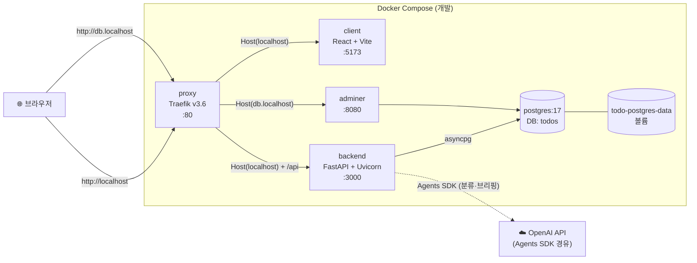
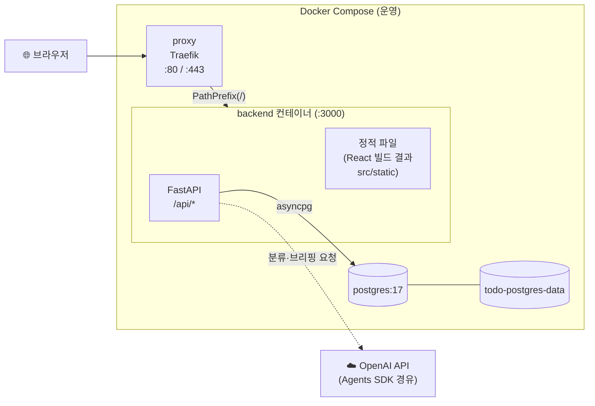
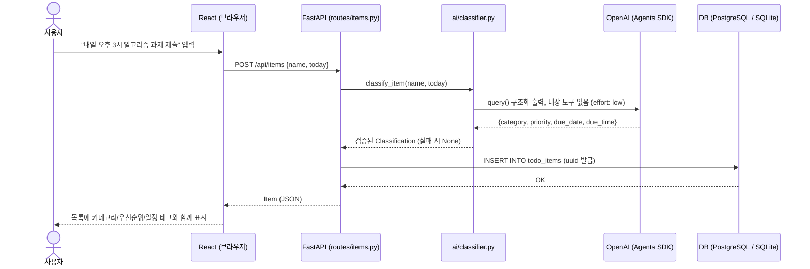
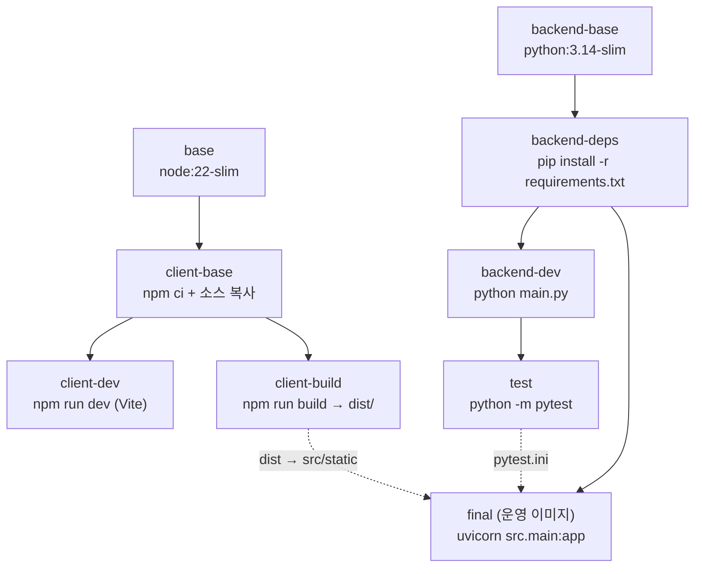
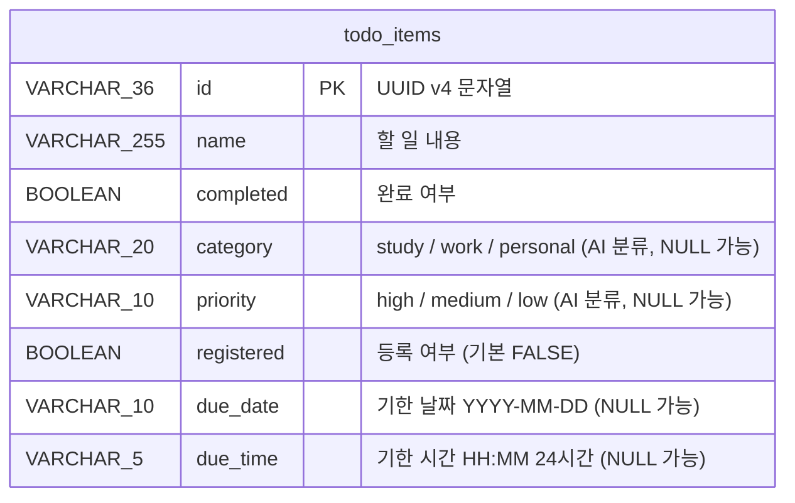

# Getting Started Todo App (FastAPI + React + OpenAI Agents SDK)

이 프로젝트는 Docker 공식 튜토리얼 예제(`getting-started-todo-app`)를 기반으로 현대적인 **클라우드 네이티브 풀스택 AI 애플리케이션**으로 재설계한 프로젝트입니다. 
Compose 파일, 최적화된 다단계(Multi-stage) Dockerfile, CI/CD, Kubernetes(KIND 및 GKE), Helm 차트 오케스트레이션 및 OpenAI Agents SDK 기반 AI 에이전트 연동에 이르기까지 프로덕션 환경의 모범 사례(Best Practices)를 완벽하게 구현하였습니다.

---

## 🌟 프로젝트 주요 기능 (Feature Highlights)

### 1. 🤖 생성형 AI (OpenAI Agents SDK) 기반 스마트 자동 분류 + 일정 브리핑 에이전트
- **자연어 심층 파싱**: 사용자가 일상 언어로 할 일을 입력(예: *"내일 오후 3시까지 클라우드컴퓨팅 과제 제출하기"*)하면, OpenAI 모델(기본 `gpt-5.6-luna`)이 문맥을 이해하여 메타데이터를 자동 추출합니다.
  - **카테고리(Category)**: `study` (공부), `work` (업무), `personal` (개인) 자동 판별
  - **우선순위(Priority)**: `high` (높음), `medium` (보통), `low` (낮음) 자동 배정
  - **마감일시(Due Date & Time)**: `YYYY-MM-DD HH:MM` 정형 일시 데이터로 자동 변환
- **OpenAI Agents SDK**: 모든 AI 기능이 `openai-agents` 의 `Agent` + `Runner` 로 동작합니다 (`AI_MODEL` 로 모델 변경 가능, `output_type` 으로 구조화 출력).
- **🆕 AI 일정 브리핑 에이전트**: 에이전트가 읽기 전용 함수 도구(`function_tool`: `get_schedule`, `search_items`, `get_category_counts`)로 할 일 DB 를 직접 조회한 뒤, 오늘 먼저 할 일·주의사항·조언을 브리핑합니다 (`POST /api/ai/briefing`, 날짜별 검색 화면의 **AI 브리핑** 버튼).
- **무중단 회복탄력성(Graceful Fallback)**: AI 키가 없거나 외부 통신 장애가 발생해도 기본 Todo CRUD 기능은 항상 100% 정상 작동합니다.
- **AI 관리 기능**: 실시간 AI 활성화 여부 확인(`/api/ai/status`) 및 기존 등록 항목에 대한 개별 재분류(`/api/items/{id}/classify`) API를 지원합니다.

### 2. 💻 현대적 프론트엔드 UX (React 19 + TypeScript + Vite 6)
- **엄격한 타입 안정성(Type-Safe)**: React 컴포넌트 전체를 TypeScript(TS/TSX)로 전면 마이그레이션하여 런타임 오류 방지.
- **다국어 지원(i18n)**: UI 우측 상단의 언어 토글 버튼으로 한국어(KO)와 영어(EN)를 실시간 전환 가능.
- **스마트 검색 & 카테고리 필터**: 키워드 실시간 검색, 완료/미완료 상태 필터링 및 카테고리별 카운트 배지 제공.
- **일정 관리 패널 (Schedule)**: 마감일시 설정, 오늘 마감 및 이번 주 마감 일정을 한눈에 모아보는 캘린더 대시보드 패널 탑재.
- **일괄 관리 (Bulk Actions)**: 다중 선택 체크박스 및 선택 항목 일괄 삭제(`BulkBar`) 지원.
- **인라인 수정 (Inline Editing)**: 항목 클릭 시 제목, 카테고리, 우선순위, 마감일시를 즉시 편집하고 저장.

### 3. ⚡ 고성능 비동기 백엔드 & 엔터프라이즈 데이터베이스
- **Python 3.14 + FastAPI**: Uvicorn ASGI 서버 기반의 고성능 비동기 RESTful API 서버. Pydantic v2 기반의 엄격한 요청/응답 검증.
- **PostgreSQL 17 (`asyncpg`)**: 비동기 풀링 커넥션을 활용한 고신뢰성 주 데이터베이스 연동.
- **SQLite (`aiosqlite`) 자동 폴백**: `POSTGRES_HOST` 환경변수 부재 시 로컬 임베디드 SQLite 파일(`/etc/todos/todo.db`)로 무설정 자동 전환.
- **K8s 네트워크 방어 로직**: 쿠버네티스 Service Link로 인해 `POSTGRES_PORT`에 `tcp://...` 주소가 주입될 경우, 포트 번호(5432)만 안전하게 추출하여 구동 실패를 원천 차단.

### 4. ☁️ 클라우드 네이티브 배포 & 오케스트레이션
- **단일 경량 프로덕션 이미지**: 빌드 스테이지에서 Vite 번들링 산출물(`dist`)을 FastAPI 정적 디렉터리(`src/static`)로 통합하여 단일 컨테이너로 서빙.
- **Kubernetes 다중 환경 지원**:
  - **KIND 로컬 클러스터**: 워커 2대 구성, NodePort(30080) 포트포워딩, `cloud-provider-kind` 로드밸런서 지원.
  - **Google Cloud GKE**: 정식 GCP VPC 및 노드 풀 배포, L4 `LoadBalancer` (외부 IP `34.47.121.94`) 및 L7 `Ingress` (`136.82.137.12`, 도메인 `www.ssu-cloud-computing-gke.com`) 연동.
- **Helm 3 차트 패키지 (3종)**:
  - `charts/getting-started-todo-app-openai-agent.local_kind`: KIND 로컬 개발용
  - `charts/getting-started-todo-app-openai-agent.github_kind`: GitHub Packages (GHCR) 연동용
  - `charts/getting-started-todo-app-openai-agent.gcp_gke`: GCP Artifact Registry 연동용
- **자동화 스크립트 체계 (`scripts/`)**: Katenary 기반의 Helm 차트 생성(`generate-chart.py`), 서비스 타입 패치(`patch-service-type.py`), 배포 매니페스트 동기화(`sync_charts.py`) 파이프라인 완비.
- **멀티 레지스트리 지원**: Local Docker 데몬, GitHub Container Registry (GHCR), GCP Artifact Registry 대응.

## 애플리케이션 아키텍처

### 1. 개발 환경 (`compose.yaml`)

개발 중에는 프론트엔드와 백엔드가 서로 다른 개발 도구를 필요로 하므로 **별도의 컨테이너**로
분리됩니다. Traefik 프록시가 요청 경로에 따라 알맞은 서비스로 전달합니다.



### 2. 운영(배포) 환경 (`compose-prod-build.yml`, `compose-prod-GitHub.yml`, Kubernetes)

배포 시에는 React 앱이 정적 HTML/CSS/JS 로 빌드되어 **백엔드 이미지 안에 포함**되고,
FastAPI 가 정적 파일로 직접 서빙합니다. 따라서 서버 사이드 렌더링(SSR)은 없습니다.
컨테이너는 **backend(프론트 포함) + postgres + proxy** 3개로 단순해집니다.



> Kubernetes(kind) 배포(`kind-deployment-Local.yaml`)에서는 같은 구성이
> `Deployment(todo-backend, replicas: 2)` + `Pod/Service(postgres)` + `PVC(todo-postgres-pvc)` +
> `Secret/ConfigMap` 으로 표현되며, `kind-service-*.yaml` 이 서비스를 노출합니다.
> 배포 절차는 [Kubernetes 배포](#kubernetes-배포)를 참고하세요.

## 동작 구조 설명

### 요청 처리 흐름 (할 일 추가)

사용자가 할 일을 입력하면 백엔드가 OpenAI Agents SDK 에이전트로 자동 분류한 뒤 DB 에 저장합니다.
**AI 분류가 실패해도 저장(CRUD)은 항상 정상 동작**하도록 설계되어 있습니다.



- 사용자가 날짜를 **직접 지정**하면 AI 가 추출한 날짜보다 **우선**합니다.
- AI 가 만든 날짜/시간은 `valid_date`, `valid_time` 으로 다시 검증하며, 날짜가 없으면 시간도 버립니다.
- API 키가 없거나 `AI_ENABLED=false` (구 이름 `AI_CLASSIFY_ENABLED` 도 인정) 이면 분류를 건너뛰고 일반 할 일 앱으로 동작합니다.

### 백엔드 계층 구조

| 계층 | 위치 | 역할 |
|------|------|------|
| 진입점 | `backend/src/main.py` | FastAPI 앱 생성, CORS, 라우터 등록, 시작/종료 시 DB 초기화·정리, `static/` 이 있으면 React 앱 서빙 |
| 라우트 | `backend/src/routes/` | `items.py`(할 일 CRUD·검색·일정·일괄삭제·재분류), `greeting.py`(다국어 인사말) |
| 모델 | `backend/src/models.py` | Pydantic 요청/응답 모델과 날짜·시간 검증 |
| AI | `backend/src/ai/` | `agent.py`(Agents SDK 공통 실행·모델 선택·오류 처리, 예외를 밖으로 던지지 않음), `classifier.py`(자동 분류), `planner.py`(함수 도구를 쓰는 일정 브리핑 에이전트) |
| 영속성 | `backend/src/persistence/` | `postgres.py`(asyncpg 커넥션 풀), `sqlite.py`(aiosqlite). `__init__.py` 가 환경변수로 구현체 선택 |

**DB 선택 규칙**: `POSTGRES_HOST`(또는 `POSTGRES_HOST_FILE`) 환경변수가 있으면 PostgreSQL,
없으면 SQLite(`SQLITE_DB_LOCATION`, 기본 `/etc/todos/todo.db`)를 사용합니다.

### 프론트엔드 구조 (`client/src`)

| 파일/폴더 | 역할 |
|-----------|------|
| `App.tsx`, `main.tsx` | 앱 진입점 |
| `components/TodoListCard.tsx` | 할 일 목록 카드 (메인 화면) |
| `components/AddNewItemForm.tsx` | 새 할 일 입력 (일정 지정 포함) |
| `components/ItemDisplay.tsx`, `ItemEditForm.tsx`, `ItemTags.tsx` | 항목 표시·수정, 카테고리/우선순위 태그 |
| `components/SearchPanel.tsx`, `DatePanel.tsx`, `DueEditor.tsx` | 검색, 일정(날짜) 조회, 기한 편집 |
| `components/BulkBar.tsx`, `useSelection.ts` | 다중 선택 및 일괄 삭제 |
| `i18n.tsx`, `i18nContext.ts` | 한국어/영어 다국어 |

### REST API

모든 엔드포인트는 `/api` 아래에 있습니다. (`/items`, `/greeting` 은 하위 호환용 별칭이며 문서에는 표시되지 않습니다.)

| 메서드 | 경로 | 설명 |
|--------|------|------|
| GET | `/api/items?q=&category=&registered=` | 목록 조회 (이름 검색·분류·등록 여부 필터) |
| POST | `/api/items` | 할 일 추가 + AI 자동 분류 |
| PUT | `/api/items/{id}` | 부분 수정 (이름, 완료, 분류, 우선순위, 등록, 일정) |
| DELETE | `/api/items/{id}` | 단건 삭제 |
| POST | `/api/items/bulk-delete` | 여러 항목 일괄 삭제 (최대 1000개) |
| POST | `/api/items/{id}/classify` | 기존 항목을 AI 로 재분류 |
| GET | `/api/categories` | 분류별 항목 개수 |
| GET | `/api/schedule?date=` 또는 `?start=&end=` | 오늘 일정(+기한 지난 미완료) 또는 기간 일정 |
| POST | `/api/ai/briefing` | AI 일정 브리핑 (에이전트가 DB 를 조회해 `focus`/`warnings`/`tips` 반환. AI 꺼짐 503, 실패 502) |
| GET | `/api/ai/status` | AI 분류 사용 가능 여부 (버튼 표시용) |
| GET | `/api/greeting?lang=ko\|en` | 인사말 |

자동 생성 API 문서는 백엔드 실행 후 `/docs`(Swagger UI)에서 볼 수 있습니다.

### 도커 이미지 빌드 단계 (`Dockerfile` 멀티스테이지)



- `client-dev`, `backend-dev` 는 개발용 컴포즈(`compose.yaml`)가 사용합니다.
- `test` 단계는 테스트가 실패하면 이미지 빌드도 실패하게 하여 CI 역할을 합니다.
- `final` 은 백엔드 + React 빌드 결과물을 하나로 묶은 운영 이미지입니다.

## DB 스키마

테이블은 **`todo_items` 하나**이며, 서버 시작 시 `CREATE TABLE IF NOT EXISTS` 로 자동 생성됩니다.



| 컬럼 | 타입 | 제약 | 설명 |
|------|------|------|------|
| `id` | VARCHAR(36) | PK (PostgreSQL) | `uuid4` 로 서버에서 생성 |
| `name` | VARCHAR(255) | | 할 일 내용 (수정 시 공백 불가, 최대 255자) |
| `completed` | BOOLEAN | | 완료 여부 |
| `category` | VARCHAR(20) | NULL 허용 | `study`(학업) / `work`(업무) / `personal`(개인). DB 에는 영문 코드, 화면에서 한글 표시 |
| `priority` | VARCHAR(10) | NULL 허용 | `high`(높음) / `medium`(보통) / `low`(낮음) |
| `registered` | BOOLEAN | 기본값 FALSE | TRUE 면 작업 목록에서 숨겨지고 **검색 대상**이 되는 보관 상태 |
| `due_date` | VARCHAR(10) | NULL 허용 | `YYYY-MM-DD`. 문자열이라 사전순 비교 = 날짜순 비교 |
| `due_time` | VARCHAR(5) | NULL 허용 | `HH:MM`. 날짜가 없으면 시간도 NULL |

**설계 포인트**

- **자동 마이그레이션**: 예전 스키마(`id, name, completed`)로 만든 DB 도 시작 시 `ALTER TABLE ... ADD COLUMN` 으로 새 컬럼이 자동 추가됩니다.
- **검색 인덱스(PostgreSQL)**: `pg_trgm` 확장의 GIN 인덱스(`idx_todo_items_name_trgm`)로 `ILIKE '%검색어%'` 검색을 가속합니다. 확장 권한이 없어도 인덱스 없이 검색은 동작합니다.
- **SQLite**: `id` 에 PK 제약이 없고, `LIKE ... ESCAPE` 로 `%`, `_` 를 문자 그대로 검색하며, 일괄 삭제 시 바인딩 변수 제한(999)을 넘지 않도록 500개씩 나눠 삭제합니다.
- **오늘 일정 쿼리**: `due_date = 오늘` 이거나 (`due_date < 오늘` 이면서 미완료) 인 항목을, 시간 없는 항목을 맨 뒤로 하여 날짜·시간순으로 정렬합니다.
- **데이터 보존**: PostgreSQL 은 `todo-postgres-data` 볼륨(K8s 는 PVC)에 저장되어 컨테이너를 지워도 유지됩니다.

## 개발

프로젝트를 실행하려면 Docker Desktop 을 설치한 뒤 다음 명령을 실행하세요.

```
git clone https://github.com/cstpeace0191/getting-started-todo-app-openAI-agent
cd getting-started-todo-app-openAI-agent
docker compose up --watch
```

여러 컨테이너 이미지가 Docker Hub 에서 다운로드되고, 잠시 후 애플리케이션이 실행됩니다.
컴퓨터에 아무것도 설치하거나 설정할 필요가 없습니다!

[http://localhost](http://localhost) 를 열어 앱이 실행 중인 것을 확인하세요.

백엔드나 프론트엔드의 변경 사항은 컨테이너를 다시 빌드하거나 재시작하지 않아도
즉시 반영됩니다. (`compose.yaml` 의 `develop.watch` 설정: 소스는 `sync`, 의존성 파일은 `rebuild`)

### `--watch` 설정이란?

`--watch` 는 **Docker Compose Watch** 기능을 켜는 옵션입니다. 컨테이너를 실행한 채로
호스트의 소스 파일 변경을 감시하다가, 변경이 감지되면 **`develop.watch` 에 정의된 규칙에 따라 자동으로
반영**합니다. 코드를 고칠 때마다 `docker compose down` → `build` → `up` 을 반복할 필요가 없습니다.

```
docker compose up --watch     # 실행 + 감시 (로그가 함께 출력됨)
docker compose watch          # 이미 떠 있는 서비스에 감시만 추가
```

각 서비스의 `develop.watch` 항목은 `path`(감시 대상)와 `action`(변경 시 동작)으로 구성됩니다.

| action | 동작 | 사용 예 |
|--------|------|---------|
| `sync` | 변경된 파일을 컨테이너 안 `target` 경로로 **즉시 복사**. 재시작 없음 (Vite HMR, uvicorn 자동 리로드가 이어서 반영) | 개발용 소스 코드 (`backend/src`, `client/src`) |
| `rebuild` | **이미지를 다시 빌드**하고 컨테이너를 교체 | 의존성 파일 (`requirements.txt`, `package.json`) |
| `sync+restart` | 파일을 복사한 뒤 컨테이너만 재시작 | 설정 파일 |

**파일별 적용 현황**

| Compose 파일 | 감시 대상 | action | 설명 |
|--------------|-----------|--------|------|
| `compose.yaml` (개발) | `backend/src`, `client/src` | `sync` | 코드 수정이 즉시 반영됨 |
| `compose.yaml` (개발) | `requirements.txt`, `package.json` | `rebuild` | 패키지가 바뀌면 이미지 재빌드 |
| `compose-prod-build.yml` (운영 빌드) | `backend/src`, `client/src`, `requirements.txt`, `package.json` 전부 | `rebuild` | 운영 이미지는 React 가 정적 파일로 빌드되어 들어 있어 `sync` 가 불가능하므로 항상 재빌드 |

운영 빌드 구성에서 감시를 쓰려면 다음과 같이 실행합니다. 변경할 때마다 빌드가 일어나므로 개발용보다 느립니다.

```
docker compose -f compose-prod-build.yml up --build --watch
```

> 참고: `watch` 는 `build:` 가 정의된 서비스에만 적용됩니다. `image:` 만 있는 서비스(`proxy`, `postgres`)와
> `compose-prod-GitHub.yml` (미리 빌드된 이미지 사용)에서는 감시할 소스가 없어 의미가 없습니다.

DB 확인을 돕기 위해 개발 스택에는 Adminer 도 포함되어 있으며
[http://db.localhost](http://db.localhost) 에서 접속할 수 있습니다
(대부분의 브라우저는 `*.localhost` 를 자동으로 해석하므로 hosts 파일을 수정할 필요가 없습니다).
Adminer 접속 정보: 시스템 `PostgreSQL`, 서버 `postgres`, 사용자 `postgres`, 비밀번호 `secret`, 데이터베이스 `todos`.

### AI 기능 설정 (선택: 자동 분류·일정 브리핑)

1. [OpenAI Platform](https://platform.openai.com/api-keys) 에서 API 키를 발급받습니다.
2. `.env.example` 을 `.env` 로 복사하고 `OPENAI_API_KEY` 값을 채웁니다.
3. 컴포즈를 실행하면 백엔드 컨테이너로 키가 전달됩니다.

| 환경변수 | 설명 |
|----------|------|
| `OPENAI_API_KEY` | OpenAI API 키 (없으면 AI 기능 비활성) |
| `OPENAI_API_KEY_FILE` | 키가 들어 있는 파일 경로 (Docker/K8s Secret 마운트용) |
| `AI_ENABLED` | `false` 로 두면 키가 있어도 AI 를 끔 (구 이름 `AI_CLASSIFY_ENABLED` 도 인정) |
| `AI_MODEL` | 사용할 모델 (기본 `gpt-5.6-luna`) |
| `OPENAI_AGENTS_DISABLE_TRACING` | (선택) `1` 이면 OpenAI 대시보드(Traces)로의 실행 기록 전송을 끔 |
| `POSTGRES_HOST` / `POSTGRES_USER` / `POSTGRES_PASSWORD` / `POSTGRES_DB` | PostgreSQL 접속 정보 (`POSTGRES_HOST` 가 있으면 PostgreSQL 사용) |
| `SQLITE_DB_LOCATION` | SQLite 사용 시 DB 파일 경로 |

> `.env` 파일에는 비밀 키가 들어 있으므로 Git 에 커밋하지 마세요.

### 로컬 실행 (Docker 없이)

Docker 없이 내 PC 에서 백엔드와 프론트엔드를 직접 실행하는 방법입니다. DB 는 별도 설정이 없으면
**SQLite** 를 사용하므로 PostgreSQL 을 설치하지 않아도 됩니다.

**준비물**: Python 3.14 이상, [uv](https://docs.astral.sh/uv/)(권장) 또는 pip, Node.js 22 이상

**1) 백엔드 실행** (터미널 1, 포트 3000)

```
cd backend
uv venv                                # 가상환경(.venv) 생성
uv pip install -r requirements.txt     # 실행 + 테스트 패키지 설치 (pip 사용 시: pip install -r requirements.txt)
```

> `uv sync` 는 `pyproject.toml` 만 보는데 여기에는 `pytest` 등 테스트 패키지가 없으므로, 테스트까지 하려면 `requirements.txt` 로 설치하세요.

PowerShell:

```
$env:SQLITE_DB_LOCATION = "$PWD\todo.db"       # 필수: 기본값(/etc/todos/todo.db)은 Windows 에 없는 경로
$env:OPENAI_API_KEY = "sk-xxxxxxxx"       # 선택: 없으면 AI 기능만 꺼짐
uv run --no-sync python main.py                # pip 사용 시: python main.py
```

macOS / Linux / Git Bash:

```
export SQLITE_DB_LOCATION="$PWD/todo.db"
export OPENAI_API_KEY=sk-xxxxxxxx
uv run --no-sync python main.py
```

> 백엔드는 `.env` 파일을 **자동으로 읽지 않습니다**. (`.env` 는 `docker compose` 가 읽는 파일입니다.)
> 로컬 실행에서는 위처럼 셸에 환경변수를 직접 설정하세요.
> `--no-sync` 는 `uv run` 이 `pyproject.toml` 기준으로 환경을 다시 맞추면서 `pytest` 등을 지우는 것을 막습니다.

`Starting server on http://0.0.0.0:3000` 이 보이면 정상입니다. [http://localhost:3000/docs](http://localhost:3000/docs) 에서 API 를 확인할 수 있습니다.

**2) 프론트엔드 실행** (터미널 2, 포트 5173)

```
cd client
npm ci
npm run dev
```

[http://localhost:5173](http://localhost:5173) 을 엽니다. Vite 개발 서버가 `/api` 요청을 `http://127.0.0.1:3000` 으로 전달(proxy)하므로
백엔드를 먼저 실행해 두어야 합니다. 코드를 수정하면 프론트엔드(HMR)와 백엔드(uvicorn `--reload`)에 자동 반영됩니다.

**(선택) 프론트엔드를 빌드해 백엔드 하나로 실행**

```
cd client
npm run build        # tsc + vite build + dist 를 backend/src/static 으로 복사
```

이후 백엔드만 실행하면 [http://localhost:3000](http://localhost:3000) 에서 화면과 API 를 함께 제공합니다. (`src/static` 이 있으면 FastAPI 가 React 앱을 서빙)

**테스트와 린트**

```
cd backend && uv run --no-sync python -m pytest   # 백엔드 (SQLite + AI 모킹, 외부 DB·API 키 불필요)
cd client  && npm run lint && npm run typecheck && npm run format-check
```

#### DB 선택: PostgreSQL 활성화 / 비활성화 (SQLite 전환)

백엔드는 시작할 때 `backend/src/persistence/__init__.py` 에서 환경변수를 확인해 DB 를 **한 번** 고릅니다.

```python
if os.getenv("POSTGRES_HOST") or os.getenv("POSTGRES_HOST_FILE"):
    _backend = postgres
else:
    _backend = sqlite
```

| 상태 | 조건 | 사용 DB |
|------|------|---------|
| 활성화 | `POSTGRES_HOST`(또는 `POSTGRES_HOST_FILE`)가 비어 있지 않게 설정됨 | PostgreSQL |
| 비활성화 | 두 변수 모두 없거나 빈 문자열 | SQLite (`SQLITE_DB_LOCATION`) |

**PostgreSQL 활성화** — PostgreSQL 이 떠 있어야 합니다. (예: `docker run -d --name todo-pg -p 5432:5432 -e POSTGRES_PASSWORD=secret -e POSTGRES_DB=todos postgres:17`)

```
# PowerShell
$env:POSTGRES_HOST = "localhost"
$env:POSTGRES_USER = "postgres"
$env:POSTGRES_PASSWORD = "secret"
$env:POSTGRES_DB = "todos"
uv run --no-sync python main.py

# macOS / Linux / Git Bash
export POSTGRES_HOST=localhost POSTGRES_USER=postgres POSTGRES_PASSWORD=secret POSTGRES_DB=todos
uv run --no-sync python main.py
```

`POSTGRES_PORT` 의 기본값은 `5432` 입니다. 비밀번호 등을 파일로 주입하려면 `POSTGRES_HOST_FILE`, `POSTGRES_PASSWORD_FILE` 처럼 `_FILE` 변형을 쓸 수 있습니다.

**비활성화 (SQLite 로 전환)** — 변수를 지우고 서버를 다시 시작합니다.

```
# PowerShell
Remove-Item Env:POSTGRES_HOST, Env:POSTGRES_USER, Env:POSTGRES_PASSWORD, Env:POSTGRES_DB -ErrorAction SilentlyContinue

# macOS / Linux / Git Bash
unset POSTGRES_HOST POSTGRES_USER POSTGRES_PASSWORD POSTGRES_DB
```

**Docker Compose 에서는**: `compose.yaml`, `compose-prod-*.yml` 의 backend 서비스에 `POSTGRES_HOST: postgres` 가 이미 들어 있어 항상 PostgreSQL 을 씁니다.
SQLite 로 바꾸려면 backend 의 `POSTGRES_*` 환경변수와 `depends_on: postgres` 를 제거하세요. (SQLite 파일은 컨테이너 안에 있어 볼륨을 붙이지 않으면 컨테이너 삭제 시 사라집니다.)

> **주의**
> - DB 선택은 서버 **시작 시 한 번**만 이루어지므로 값을 바꾼 뒤에는 서버를 재시작해야 합니다.
> - PostgreSQL 과 SQLite 는 데이터가 서로 **공유되지 않습니다**. 전환하면 기존 할 일 목록이 보이지 않습니다. (사라진 것이 아니라 다른 DB 에 남아 있습니다.)
> - 실행 시 `Using sqlite database at ...` 로그가 보이면 SQLite 를 쓰고 있는 것입니다.

### 운영 이미지로 실행

프론트엔드를 빌드해 백엔드에 포함한 운영용 구성을 로컬에서 확인하려면 다음을 실행합니다.

```
docker compose -f compose-prod-build.yml up --build
```

`compose-prod-build.yml` 은 운영 이미지를 **`todo-openai-agent:prod`** 라는 이름으로 빌드합니다.
이 이미지를 아래 절차로 레지스트리에 올리면, 다른 컴퓨터·Kubernetes(GKE 등)에서 내려받아 쓸 수 있습니다.

| 대상 레지스트리 | 이미지 전체 이름 | 사용하는 YAML |
|-----------------|------------------|---------------|
| 로컬 | `todo-openai-agent:prod` | `compose-prod-build.yml`, `kind-deployment-Local.yaml` |
| GitHub (ghcr.io) | `ghcr.io/<Your registry>/todo-openai-agent:prod` (예: `ghcr.io/cstpeace0191/todo-openai-agent:prod`) | `compose-prod-GitHub.yml`, `GKE-deployment-GitHub.yaml` |
| GCP Artifact Registry | `asia-northeast3-docker.pkg.dev/<Your GCP Project ID>/<Your name-repo>/todo-openai-agent:prod` (예: `asia-northeast3-docker.pkg.dev/ssu-agent-vertex-509708/suntaechung-repo/todo-openai-agent:prod`) | `compose-prod-GCPRegistry.yml`, `GKE-deployment-GCP.yaml` |

### GitHub 레지스트리(ghcr.io)에 이미지 push 하기

`<Your registry>` 는 본인의 GitHub 사용자명(또는 조직명)입니다. 이 문서에서는 예시로 `cstpeace0191` 을 사용합니다.
레지스트리 주소와 사용자명은 **반드시 소문자**여야 합니다.

**1) 이미지 빌드** — 이미 `docker compose -f compose-prod-build.yml build` 를 했다면 `todo-openai-agent:prod` 가 만들어져 있습니다. 직접 빌드하려면:

```
docker build --target final -t todo-openai-agent:prod .
```

**2) 태깅** — 로컬 이미지에 레지스트리 경로가 포함된 이름을 하나 더 붙입니다. (이미지가 복사되는 것이 아니라 이름만 추가됩니다.)

```
docker tag todo-openai-agent:prod ghcr.io/<Your registry>/todo-openai-agent:prod
# 예시
docker tag todo-openai-agent:prod ghcr.io/cstpeace0191/todo-openai-agent:prod
```

**3) Docker 에서 GitHub 인증** — GitHub 비밀번호는 사용할 수 없고 **Personal Access Token(classic)** 이 필요합니다.

1. GitHub → Settings → Developer settings → Personal access tokens → **Tokens (classic)** → *Generate new token (classic)*
2. 권한(scope)은 `write:packages` (이미지를 받기만 하려면 `read:packages`) 를 선택하고 토큰을 복사합니다.
3. 토큰을 환경변수에 넣고 로그인합니다. (토큰이 셸 기록에 남지 않도록 `--password-stdin` 사용)

PowerShell:

```
$env:GHCR_TOKEN = "ghp_xxxxxxxxxxxxxxxxxxxx"
$env:GHCR_TOKEN | docker login ghcr.io -u <Your registry> --password-stdin
```

macOS / Linux / Git Bash:

```
export GHCR_TOKEN=ghp_xxxxxxxxxxxxxxxxxxxx
echo $GHCR_TOKEN | docker login ghcr.io -u <Your registry> --password-stdin
# 예시
echo $GHCR_TOKEN | docker login ghcr.io -u cstpeace0191 --password-stdin

```

`Login Succeeded` 가 출력되면 인증이 끝난 것입니다. (인증 정보는 Docker 의 자격 증명 저장소에 보관됩니다.)

**4) GitHub Repository(Packages) 에 push**

```
docker push ghcr.io/<Your registry>/todo-openai-agent:prod
# 예시
docker push ghcr.io/cstpeace0191/todo-openai-agent:prod
```

push 가 끝나면 GitHub 프로필의 **Packages** 탭에서 `getting-started-todo-app-openai-agent` 를 확인할 수 있습니다.

#### 4-1) GitHub 패키지를 Public으로 전환하기 (권장)
GitHub Packages(ghcr.io)에 처음 push된 이미지는 기본값이 **Private(비공개)** 입니다. Private 상태에서는 외부 클러스터(GKE, kind 등)에서 이미지를 가져올 때 인증 오류(`ErrImagePull`, `ImagePullBackOff`)가 발생하므로, 누구나 받을 수 있도록 **Public**으로 전환하는 것이 가장 편리합니다:

1. **GitHub 웹사이트 접속** 후 우측 상단 프로필 아이콘 → **Your profile** 클릭
2. 상단 탭 중 **Packages** 클릭 → 방금 push한 **`getting-started-todo-app-openai-agent`** 패키지 클릭
3. 우측 하단의 **Package settings** 클릭
4. 페이지 맨 아래 **Danger Zone** 섹션으로 스크롤 이동
5. **Change package visibility** (또는 Change visibility) 버튼 클릭
6. **Public** 을 선택하고 안내 문구에 따라 패키지 이름(`getting-started-todo-app-openai-agent`)을 입력한 뒤 확인 버튼 클릭
7. ✅ 이제 GKE나 kind 등 어떤 환경에서도 별도의 인증 Secret(`imagePullSecrets`) 없이 즉시 이미지를 pull할 수 있습니다.

> 🔒 **Private 상태를 유지해야 하는 경우**:
> 패키지를 공개하지 않고 Private으로 유지해야 한다면, 아래 [GKE 배포 가이드의 GHCR 인증 섹션](#githubghcrio-이미지-사용-시-인증-imagepullsecrets)을 참고하여 클러스터에 Secret을 등록해야 합니다.

**5) 확인** — 다른 환경에서 받아 실행해 봅니다.

```
docker compose -f compose-prod-GitHub.yml up -d
```

### GCP Artifact Registry 에 이미지 push 하기

사용 값 (이 문서의 표기 / 예시):

| 표기 | 의미 | 예시 |
|------|------|------|
| `<Your GCP Project ID>` | GCP 프로젝트 **ID** (이름이 아님) | `ssu-agent-vertex-509708` |
| `<Your name-repo>` | Artifact Registry 저장소 이름 | `suntaechung-repo` |
| 리전 | 서울 | `asia-northeast3` |

최종 이미지 이름:

```
asia-northeast3-docker.pkg.dev/<Your GCP Project ID>/<Your name-repo>/todo-openai-agent:prod
# 예시
asia-northeast3-docker.pkg.dev/ssu-agent-vertex-509708/suntaechung-repo/todo-openai-agent:prod
```

**1) Windows 에 gcloud CLI 설치**

방법 A — 설치 프로그램: [Google Cloud CLI 설치 문서](https://cloud.google.com/sdk/docs/install) 에서 *Windows* 용
`GoogleCloudSDKInstaller.exe` 를 내려받아 실행합니다.

방법 B — winget (PowerShell):

```
winget install -e --id Google.CloudSDK
```

설치 후 **새 PowerShell 창**을 열어 확인합니다. (PATH 가 갱신되어야 합니다.)

```
gcloud --version
```

**2) gcloud 로그인 및 프로젝트 지정**

```
gcloud auth login
gcloud config set project <Your GCP Project ID>
# 예시
gcloud config set project ssu-agent-vertex-509708
```

`gcloud auth login` 을 실행하면 브라우저가 열리므로 GCP 계정으로 로그인합니다.
해당 프로젝트에 **Artifact Registry 쓰기 권한**(`roles/artifactregistry.writer` 이상)이 있어야 push 할 수 있습니다.

**3) Artifact Registry API 활성화 및 저장소 생성**

gcloud 로 레지스트리에 push 할 수 있도록 프로젝트에서 API 를 켭니다. (프로젝트당 한 번, 결제 계정이 연결되어 있어야 합니다.)

```
gcloud services enable artifactregistry.googleapis.com
```

Docker 이미지를 담을 저장소가 없다면 생성합니다.

```
gcloud artifacts repositories create <Your name-repo> --repository-format=docker --location=asia-northeast3 --description="getting-started-todo-app-openai-agent images"
# 예시
gcloud artifacts repositories create suntaechung-repo --repository-format=docker --location=asia-northeast3 --description="getting-started-todo-app-openai-agent images"
```

확인:

```
gcloud services list --enabled --filter="name:artifactregistry.googleapis.com"
gcloud artifacts repositories list --location=asia-northeast3
```

**4) Docker 에서 GCP Registry 인증**

gcloud 가 Docker 의 자격 증명 도우미(credential helper)로 등록되도록 한 번만 실행합니다.
(`~/.docker/config.json`(Windows: `%USERPROFILE%\.docker\config.json`) 에 해당 호스트가 추가됩니다.)

```
gcloud auth configure-docker asia-northeast3-docker.pkg.dev
```

확인 질문(`Do you want to continue (Y/n)?`)에 `Y` 를 입력합니다.

**5) 태깅**

```
docker tag todo-openai-agent:prod asia-northeast3-docker.pkg.dev/<Your GCP Project ID>/<Your name-repo>/todo-openai-agent:prod
# 예시
docker tag todo-openai-agent:prod asia-northeast3-docker.pkg.dev/ssu-agent-vertex-509708/suntaechung-repo/todo-openai-agent:prod
```

**6) GCP Artifact Registry 에 push**

```
docker push asia-northeast3-docker.pkg.dev/<Your GCP Project ID>/<Your name-repo>/todo-openai-agent:prod
# 예시
docker push asia-northeast3-docker.pkg.dev/ssu-agent-vertex-509708/suntaechung-repo/todo-openai-agent:prod
```

push 확인:

```
gcloud artifacts docker images list asia-northeast3-docker.pkg.dev/<Your GCP Project ID>/<Your name-repo>
```

**7) 받아서 실행**

```
docker compose -f compose-prod-GCPRegistry.yml up -d
```

GKE 에서는 `GKE-deployment-GCP.yaml` 의 `image:` 가 위 이미지를 가리킵니다. 같은 프로젝트의 GKE 노드는
기본 서비스 계정으로 같은 프로젝트의 Artifact Registry 를 읽을 수 있습니다. (다른 프로젝트라면 해당 서비스 계정에
`roles/artifactregistry.reader` 를 부여하세요.)

> **YAML 수정 안내**: 본인 환경에서는 `compose-prod-GitHub.yml`, `GKE-deployment-GitHub.yaml` 의 `cstpeace0191`,
> `compose-prod-GCPRegistry.yml`, `GKE-deployment-GCP.yaml` 의 `ssu-agent-vertex-509708` / `suntaechung-repo` 를
> 본인의 `<Your registry>`, `<Your GCP Project ID>`, `<Your name-repo>` 값으로 바꿔 사용하세요.

### 테스트

백엔드 테스트는 `backend/spec/` 아래에 있습니다 (`routes`, `persistence`, `ai`).

```
docker build --target test .
```

### 정리하기

작업이 끝나면 다음 명령으로 컨테이너를 제거합니다.

```
docker compose down
```

데이터베이스 볼륨까지 삭제하려면 `docker compose down -v` 를 사용하세요.

## Kubernetes 배포

운영 이미지(`todo-openai-agent:prod`)를 Kubernetes 에 배포하는 두 가지 방법입니다.
Deployment 매니페스트는 모두 **같은 구조**(Secret + ConfigMap + PVC + `postgres` Pod/Service + `todo-backend` Deployment)이며
이미지 위치와 스토리지 클래스만 다릅니다.

| 매니페스트 | 대상 | 이미지 | PVC 스토리지 클래스 |
|------------|------|--------|---------------------|
| `kind-deployment-Local.yaml` | kind | `todo-openai-agent:prod` (로컬 빌드, `kind load` 로 주입) | `standard` (1Gi) |
| `kind-deployment-GitHub.yaml` | kind | `ghcr.io/<Your registry>/todo-openai-agent:prod` | `standard` (1Gi) |
| `GKE-deployment-GitHub.yaml` | GKE | `ghcr.io/<Your registry>/todo-openai-agent:prod` | `standard-rwo` (10Gi) |
| `GKE-deployment-GCP.yaml` | GKE | `asia-northeast3-docker.pkg.dev/<Your GCP Project ID>/<Your name-repo>/todo-openai-agent:prod` | `standard-rwo` (10Gi) |

공통 사항:

- DB 접속 정보는 `todo-config`(ConfigMap: `POSTGRES_HOST=postgres`, `POSTGRES_USER`, `POSTGRES_DB`)와
  `todo-db-secret`(Secret: `POSTGRES_PASSWORD`)으로 주입됩니다. 실습용 비밀번호 `secret` 은 운영에서 반드시 바꾸세요.
- `todo-backend`(replicas 2)의 initContainer 가 `postgres:5432` 가 열릴 때까지 기다린 뒤 앱이 시작됩니다.
  **두 레플리카가 같은 PostgreSQL 을 공유**하므로 어느 Pod 로 접속해도 같은 데이터가 보입니다.
- 헬스체크는 `GET /api/items` 입니다.
- (선택) AI 기능(분류·브리핑)을 쓰려면 키 Secret 을 만드세요. 없어도 앱은 일반 Todo 앱으로 정상 동작합니다.
  Secret 을 Deployment 적용 후에 만들었다면 `kubectl rollout restart deployment/todo-backend` 로 Pod 를 다시 시작합니다.

  ```
  kubectl create secret generic todo-ai-secret --from-literal=OPENAI_API_KEY=sk-xxxxxxxx
  ```

- `postgres` 는 단일 Pod(레플리카 없음)입니다. 실습용 구성이며, 운영에서는 StatefulSet 또는 관리형 DB(Cloud SQL 등)를 권장합니다.

### Service 종류 (`kind-service-*.yaml`, `GKE-service-*.yaml`)

| 파일 | 서비스 이름 | 타입 | 접근 방법 |
|------|-------------|------|-----------|
| `*-service-cip.yaml` | `todo-backend-cip` | ClusterIP (80 → 3000) | 클러스터 내부 전용. `kubectl port-forward` 또는 Ingress 백엔드 |
| `*-service-np.yaml` | `todo-backend-np` | NodePort (`30080`) | `<노드 IP>:30080` |
| `*-service-lb.yaml` | `todo-backend-lb` | LoadBalancer (80 → 3000) | 외부 IP 로 `http://<EXTERNAL-IP>` (GKE 에서 자동 생성) |

> 세 서비스는 같은 Pod(`app: todo-backend`)를 가리키므로 필요한 것만 골라 적용하면 되고, 함께 적용해도 충돌하지 않습니다.

---

### A. kind 에 배포하기

kind(Kubernetes IN Docker)는 Docker 컨테이너를 노드로 사용하는 로컬 클러스터입니다. Docker Desktop 이 실행 중이어야 합니다.

**1) kind, kubectl 설치**

Windows (PowerShell):

```
winget install Kubernetes.kind
winget install Kubernetes.kubectl
```

macOS: `brew install kind kubectl` / Linux: [kind 설치 문서](https://kind.sigs.k8s.io/docs/user/quick-start/#installation) 참고.
새 터미널을 열어 확인합니다.

```
kind version
kubectl version --client
```

**2) kind 클러스터 생성 (`kind-config-2workers.yaml`)**

구성 파일은 **control-plane 1개 + worker 2개** 클러스터를 만들고, control-plane 의 80/443/30080 포트를 호스트(localhost)로 연결합니다.
(80/443 은 Ingress 용, 30080 은 NodePort 서비스 용)

```
kind create cluster --name my-k8s --config kind-config-2workers.yaml
```

> 호스트의 80/443/30080 포트를 다른 프로그램(예: 개발용 `docker compose up` 의 Traefik)이 쓰고 있으면 생성에 실패합니다. 먼저 `docker compose down` 하세요.

**3) kubectl 이 kind 클러스터를 바라보도록 구성**

kind 는 클러스터 생성 시 `~/.kube/config` 에 컨텍스트 `kind-<클러스터 이름>` 을 자동으로 추가하고 현재 컨텍스트로 전환합니다.

```
kubectl config get-contexts                      # 컨텍스트 목록 (* 가 현재)
kubectl config use-context kind-todo-cluster     # 다른 클러스터(GKE 등)를 보고 있었다면 전환
kubectl cluster-info --context kind-todo-cluster
kubectl get nodes                                # 3개 노드(control-plane 1 + worker 2)가 Ready 인지 확인
```

> `The connection to the server localhost:8080 was refused` 오류는 현재 컨텍스트가 없다는 뜻입니다.
> `kind export kubeconfig --name todo-cluster` 로 kubeconfig 를 다시 만들 수 있습니다.

**4) 이미지를 kind 노드에 적재 (`kind load docker-image`)**

kind 노드는 호스트의 Docker 이미지 저장소와 **분리**되어 있어, 로컬에서 빌드한 `todo-openai-agent:prod` 를 노드 안으로 직접 넣어야 합니다.
(`kind-deployment-Local.yaml` 은 `imagePullPolicy: IfNotPresent` 로 이 이미지를 사용합니다.)

```
docker build --target final -t todo-openai-agent:prod .
kind load docker-image todo-openai-agent:prod --name my-k8s
```

> 이미지를 다시 빌드한 뒤에는 `kind load` 를 다시 실행하고 `kubectl rollout restart deployment/todo-backend` 로 반영합니다.
> GHCR 이미지(`kind-deployment-GitHub.yaml`)를 쓰면 이 단계가 필요 없습니다. (이미지가 private 이면 `imagePullSecrets` 필요)

**5) 매니페스트 적용 (`kind-deployment-Local.yaml`)**

```
kubectl apply -f kind-deployment-Local.yaml
kubectl get pods -w                  # postgres Running(1/1) → todo-backend 2개 Running(1/1) 확인 (Ctrl+C 로 종료)
kubectl get pvc                      # todo-postgres-pvc 가 Bound 인지 확인
```

`ErrImagePull`/`ImagePullBackOff` 가 보이면 4)의 `kind load` 를 빠뜨렸거나 클러스터 이름(`--name`)이 다른 경우입니다.
`kubectl describe pod <이름>`, `kubectl logs deploy/todo-backend` 로 원인을 확인하세요.

**6) Service 적용 및 접속 (`kind-service-*.yaml`)**

```
kubectl apply -f kind-service-cip.yaml
kubectl apply -f kind-service-np.yaml
kubectl apply -f kind-service-lb.yaml     # (선택) 아래 표 참고
kubectl get svc
```

| 서비스 | 접속 방법 |
|--------|-----------|
| ClusterIP (`todo-backend-cip`) | `kubectl port-forward svc/todo-backend-cip 8080:80` 후 [http://localhost:8080](http://localhost:8080) |
| NodePort (`todo-backend-np`) | `kind-config-2workers.yaml` 의 포트 매핑 덕분에 [http://localhost:30080](http://localhost:30080) |
| LoadBalancer (`todo-backend-lb`) | kind 에는 로드밸런서가 없어 `EXTERNAL-IP` 가 `<pending>` 으로 남습니다. [cloud-provider-kind](https://github.com/kubernetes-sigs/cloud-provider-kind) 를 별도로 실행해야 IP 가 할당됩니다. |

**7) (선택) Ingress 로 접속 (`kind-ingress.yaml`)**

NGINX Ingress Controller 를 설치한 뒤 적용합니다. (구성 파일의 `ingress-ready=true` 라벨과 80/443 포트 매핑이 이를 위한 설정입니다.)

```
kubectl apply -f https://kind.sigs.k8s.io/examples/ingress/deploy-ingress-nginx.yaml
kubectl wait --namespace ingress-nginx --for=condition=ready pod  \                      --selector=app.kubernetes.io/component=controller --timeout=180s
kubectl apply -f kind-service-cip.yaml      # Ingress 의 백엔드 서비스
kubectl apply -f kind-ingress.yaml
```

[http://localhost](http://localhost) 로 접속합니다. (`www.ssu-cloud-computing-local.com` 호스트로 접속하려면 hosts 파일에 `127.0.0.1 www.ssu-cloud-computing-local.com` 을 추가)

**8) 정리**

```
kubectl delete -f kind-ingress.yaml -f kind-service-cip.yaml -f kind-service-np.yaml -f kind-service-lb.yaml --ignore-not-found
kubectl delete -f kind-deployment-Local.yaml      # PVC 도 함께 삭제되어 DB 데이터가 사라집니다
kind delete cluster --name todo-cluster           # 클러스터 전체 삭제
```

---

### B. GKE(Google Kubernetes Engine)에 배포하기

사전 준비: GCP 프로젝트(결제 계정 연결), gcloud CLI([설치 방법](#gcp-artifact-registry-에-이미지-push-하기) 1)~2) 참고), 레지스트리에 push 된 이미지
(GHCR 은 **Public** 이어야 합니다. GCP Artifact Registry 는 같은 프로젝트의 GKE 노드가 기본 권한으로 읽을 수 있습니다).

아래 예시는 `<Your GCP Project ID>` = `ssu-agent-vertex-509708`, 클러스터 이름 `suntaechung-k8s-cluster`, 영역 `asia-northeast3-a` 입니다.

**1) gcloud 로그인 및 프로젝트 지정**

```
gcloud auth login
gcloud config set project <Your GCP Project ID>
#예시
gcloud config set project ssu-agent-vertex-509708

gcloud config set compute/zone asia-northeast3-a
```

**2) GKE 관련 API 활성화** (프로젝트당 한 번)

```
gcloud services enable container.googleapis.com compute.googleapis.com
# Artifact Registry 이미지를 쓰면 (이미 했다면 생략)
gcloud services enable artifactregistry.googleapis.com
```

**3) kubectl 의 GKE 인증 플러그인 설치**

최신 kubectl 은 GKE 인증에 `gke-gcloud-auth-plugin` 이 필요합니다. (없으면 `executable gke-gcloud-auth-plugin not found` 오류)

```
gcloud components install kubectl gke-gcloud-auth-plugin
gke-gcloud-auth-plugin --version
```

> gcloud 를 패키지 관리자(apt, winget 등)로 설치했다면 `gcloud components` 가 막혀 있을 수 있습니다.
> 이 경우 별도 패키지(`google-cloud-cli-gke-gcloud-auth-plugin`)로 설치하세요.

**4) GKE 클러스터 생성 (worker node 2개)**

```
gcloud container clusters create suntaechung-k8s-cluster --zone asia-northeast3-a --num-nodes 2 --machine-type e2-medium --disk-size 30
```

- `--zone` 으로 단일 영역 클러스터를 만들면 `--num-nodes 2` 가 **노드 2개**입니다. (`--region` 으로 만들면 영역마다 2개씩 생성되므로 주의)
- `e2-medium`(2 vCPU, 4GB) 2대면 이 앱(backend 2 + postgres 1)에 충분합니다. 생성에는 몇 분이 걸립니다.
- 기본값은 VPC-native 클러스터이며 Ingress 가 컨테이너 기반 로드밸런싱(NEG)을 사용합니다.
- Autopilot 이 아닌 **Standard** 모드입니다. 비용 발생을 막으려면 실습 후 반드시 클러스터를 삭제하세요.

**5) kubectl 이 GKE 클러스터를 바라보도록 구성**

`clusters create` 는 kubeconfig 에 컨텍스트를 자동 추가합니다. 나중에 다시 연결하거나 다른 PC 에서 쓸 때는 다음을 실행합니다.

```
## gcloud container clusters get-credentials suntaechung-k8s-cluster --zone asia-northeast3-a --project <Your GCP Project ID>
##  예시
gcloud container clusters get-credentials suntaechung-k8s-cluster --zone asia-northeast3-a --project ssu-agent-vertex-509708
```

컨텍스트 이름은 `gke_<프로젝트 ID>_<영역>_<클러스터 이름>` 형식입니다.

```
kubectl config get-contexts                                  # 컨텍스트 목록
kubectl config current-context                               # 현재 컨텍스트
kubectl config use-context gke_<프로젝트 ID>_<영역>_<클러스터 이름>   # kind 와 GKE 전환
## 예시
kubectl config use-context gke_ssu-agent-vertex-509708_asia-northeast3-a_suntaechung-k8s-cluster   

kubectl get nodes                                            # 노드 2개 Ready 확인
```

> **주의**: 같은 PC 에 kind 와 GKE 컨텍스트가 모두 있으므로, `kubectl apply` 전에 `kubectl config current-context` 로
> 의도한 클러스터인지 꼭 확인하세요.
> 인증은 `gcloud auth login` 의 계정을 사용합니다. 토큰이 만료되어 `Unauthorized`/`reauthentication` 오류가 나면 `gcloud auth login` 을 다시 실행합니다.

**6) 매니페스트 적용**

GCP Artifact Registry 이미지:

```
kubectl apply -f GKE-deployment-GCP.yaml
```

GitHub(ghcr.io) 이미지:

```bash
kubectl apply -f GKE-deployment-GitHub.yaml
```

##### 💡 GitHub(ghcr.io) 이미지 사용 시 인증 (imagePullSecrets)

- **경우 1) GitHub 패키지가 Public인 경우 (권장)**:
  - 위 4-1단계에서 패키지를 Public으로 전환했다면 별도 인증 설정 없이 바로 이미지를 pull할 수 있습니다.
- **경우 2) GitHub 패키지가 Private인 경우 (인증 필수)**:
  - 인증 없이 배포하면 `ErrImagePull` 또는 `ImagePullBackOff` 에러가 발생합니다.
  - 아래 순서로 GKE에 Secret을 생성하고 등록합니다:

  1. **GitHub PAT(Personal Access Token) 준비**:
     - GitHub → Settings → Developer settings → Personal access tokens (classic) → `read:packages` 권한으로 토큰 생성
  2. **GKE에 Docker Registry Secret 생성**:
     ```bash
     kubectl create secret docker-registry ghcr-secret \
       --docker-server=ghcr.io \
       --docker-username=<GitHub-사용자명> \
       --docker-password=<GitHub-PAT-토큰> \
       --docker-email=<GitHub-이메일>
     ```
  3. **Secret 연동 (2가지 방법 중 택 1)**:
     - **방법 A (`GKE-deployment-GitHub.yaml` 에 명시)**:
       `spec.template.spec` 아래에 `imagePullSecrets` 를 추가합니다:
       ```yaml
       spec:
         template:
           spec:
             imagePullSecrets:
               - name: ghcr-secret
             containers:
               - name: backend
                 image: ghcr.io/<Your registry>/todo-openai-agent:prod
       ```
     - **방법 B (기본 ServiceAccount에 자동 연결 - YAML 수정 불필요, 추천)**:
       네임스페이스의 기본 계정에 시크릿을 패치하면 모든 파드가 자동으로 인증을 사용합니다:
       ```bash
       kubectl patch serviceaccount default -p '{"imagePullSecrets": [{"name": "ghcr-secret"}]}'
       ```

> 둘 다 같은 이름의 리소스를 만들므로 **둘 중 하나만** 적용합니다. 본인의 레지스트리 값으로 `image:` 를 수정해야 합니다.

```
kubectl get pods -w          # postgres 1개 + todo-backend 2개가 Running(1/1) 이 될 때까지
kubectl get pvc              # todo-postgres-pvc → Bound (GCP Persistent Disk 가 자동 생성됨)
kubectl logs deploy/todo-backend
```

**7) Service 적용 및 접속 (`GKE-service-*.yaml`)**

```
kubectl apply -f GKE-service-cip.yaml
kubectl apply -f GKE-service-np.yaml
kubectl apply -f GKE-service-lb.yaml
kubectl get svc -w           # todo-backend-lb 의 EXTERNAL-IP 가 <pending> → IP 로 바뀔 때까지 대기
```

| 서비스 | 접속 방법 |
|--------|-----------|
| LoadBalancer (`todo-backend-lb`) | `EXTERNAL-IP` 가 할당되면 `http://<EXTERNAL-IP>` (가장 간단한 외부 접속 방법) |
| NodePort (`todo-backend-np`) | `http://<노드 외부 IP>:30080` (아래 NodePort 방화벽 설정 필수) |
| ClusterIP (`todo-backend-cip`) | 클러스터 내부 전용. `kubectl port-forward svc/todo-backend-cip 8080:80` |

#### NodePort (`todo-backend-np`) 접속 상세 안내

`kubectl apply -f GKE-service-np.yaml` 적용 후 노드의 외부 IP로 접속하려면 다음 절차를 진행합니다:

1. **GCP VM 인스턴스 External IP 확인**:
   - **GCP 웹 콘솔**: *Compute Engine* → *VM 인스턴스* 메뉴에서 클러스터 노드 VM(예: `gke-suntaechung-k8s-clus-default-pool-...`)의 **외부 IP(External IP)**를 확인합니다.
   - 또는 CLI: `kubectl get nodes -o wide` 명령어의 `EXTERNAL-IP` 열 확인

2. **GCP 방화벽에서 30080 포트 허용 (NodePort 접속 시 필수)**:
   - GKE의 VPC 네트워크는 기본적으로 외부에서 노드로 들어오는 30080 포트를 차단하므로, 방화벽을 열어주지 않으면 `ERR_CONNECTION_TIMED_OUT`이 발생합니다.
   - 터미널에서 아래 명령어를 실행하여 30080 포트를 외부로 개방합니다:

   ```bash
   gcloud compute firewall-rules create allow-todo-nodeport --allow tcp:30080
   ```

3. **브라우저 접속**:
   - 방화벽 규칙 생성이 완료(약 5~10초)된 후, 브라우저에서 노드 외부 IP와 30080 포트로 접속하면 즉시 열립니다:
     - 1번 노드 예시: [http://34.64.185.174:30080/](http://34.64.185.174:30080/)
     - 2번 노드 예시: [http://34.64.210.32:30080/](http://34.64.210.32:30080/)

   *(두 노드 중 어느 외부 IP로 접속해도 NodePort 서비스가 파드로 트래픽을 자동 라우팅합니다.)*

**8) (선택) Ingress 로 접속 (`GKE-ingress.yaml`)**

GKE 의 `gce` Ingress 는 Google Cloud 의 실제 **외부 HTTP(S) 부하 분산기(L7 Load Balancer)**를 프로비저닝하며, 백엔드로 **NodePort(또는 NEG)** 서비스가 필요합니다.
그래서 이 파일은 `todo-backend-np` 를 가리킵니다. (먼저 `GKE-service-np.yaml` 적용 필수)

```bash
kubectl apply -f GKE-service-np.yaml
kubectl apply -f GKE-ingress.yaml
```

#### 1단계: 외부 IP 할당 확인 (약 5~15분 소요)

터미널에서 아래 명령어로 Ingress 상태를 확인합니다:

```bash
kubectl get ingress
```

GKE Ingress 컨트롤러는 백그라운드에서 Google Cloud 외부 L7 부하분산기(Load Balancer, Forwarding Rule, URL Map, Backend Service, 상태 확인 등)를 자동 프로비저닝합니다. 이 작업에는 약 5~15분이 소요되므로 초기에는 아래처럼 `ADDRESS` 열이 비어 있습니다:

```text
NAME                   CLASS   HOSTS                             ADDRESS   PORTS   AGE
todo-backend-ingress   gce     www.ssu-cloud-computing-gke.com             80      16m
```

로드밸런서 생성이 완료되면 `ADDRESS` 에 고유 공인 IP가 할당됩니다 (`-w` 옵션을 주면 실시간으로 변경을 감시할 수 있습니다):

```bash
kubectl get ingress -w
```

할당 완료 예시:
```text
NAME                   CLASS   HOSTS                             ADDRESS         PORTS   AGE
todo-backend-ingress   gce     www.ssu-cloud-computing-gke.com   136.82.137.12   80      29m
```

*(IP가 표시되면 `Ctrl + C` 로 빠져나옵니다.)*

#### 2단계: Ingress 접속 방법 (3가지)

`GKE-ingress.yaml` 에는 호스트 규칙(`host: www.ssu-cloud-computing-gke.com`)이 정의되어 있으므로 다음 3가지 방법 중 하나로 접속합니다:

##### 방법 A. Windows hosts 파일 등록 후 브라우저 접속 (권장)
1. 메모장(또는 텍스트 편집기)을 **관리자 권한으로 실행**합니다.
2. `C:\Windows\System32\drivers\etc\hosts` 파일을 열고 맨 아래에 다음 한 줄을 추가합니다:
   ```text
   <할당받은-INGRESS-IP>  www.ssu-cloud-computing-gke.com
   ```
   *(실제 예시: `136.82.137.12  www.ssu-cloud-computing-gke.com`)*
3. 브라우저에서 도메인으로 접속합니다:
   👉 **[http://www.ssu-cloud-computing-gke.com](http://www.ssu-cloud-computing-gke.com)**

##### 방법 B. curl 명령어로 즉시 테스트
터미널에서 `Host` 헤더를 함께 전달하여 정상 동작을 확인합니다:
```bash
curl -i -H "Host: www.ssu-cloud-computing-gke.com" http://<할당받은-INGRESS-IP>/
# 실제 예시:
curl -i -H "Host: www.ssu-cloud-computing-gke.com" http://136.82.137.12/
```

##### 방법 C. 도메인 없이 브라우저에서 IP 로 바로 접속하고 싶을 때
현재 `GKE-ingress.yaml` 에는 `defaultBackend` 가 지정되어 있으므로 도메인 없이 브라우저에 **`http://<할당받은-INGRESS-IP>/`** (예: `http://136.82.137.12/`) 로도 바로 접속이 가능합니다.
만약 호스트 제약 자체를 완전히 없애려면 `GKE-ingress.yaml` 에서 `host: www.ssu-cloud-computing-gke.com` 줄을 지우거나 주석 처리한 후 다시 적용하면 됩니다:
```yaml
spec:
  ingressClassName: gce
  rules:
  - http:                          # host: 줄 제거
      paths:
      - path: /
        pathType: Prefix
        backend:
          service:
            name: todo-backend-np
            port:
              number: 80
```
적용(`kubectl apply -f GKE-ingress.yaml`) 후 브라우저에서 **`http://<할당받은-INGRESS-IP>/`** 로 바로 접속할 수 있습니다.

> 💡 **초기 502 오류 안내**:
> IP 가 생성된 직후 약 1~2분 동안은 GCP 로드밸런서가 백엔드 파드로 상태 확인(Health Check) 프로브를 전송하여 정상 여부를 확인하는 중이므로 `502 Bad Gateway` 가 뜰 수 있습니다. 잠시 후 자동으로 정상(200 OK) 화면이 뜹니다.
> 
> Ingress 를 사용하면 외부 접속을 Ingress 가 담당하므로 `todo-backend-lb` 는 적용하지 않아도 됩니다. (비용 절감)

**9) 정리 (비용 방지)**

```
kubectl delete -f GKE-ingress.yaml -f GKE-service-lb.yaml -f GKE-service-np.yaml -f GKE-service-cip.yaml --ignore-not-found
kubectl delete -f GKE-deployment-GCP.yaml          # 또는 GKE-deployment-GitHub.yaml. PVC 삭제 시 디스크도 삭제됨
gcloud container clusters delete suntaechung-k8s-cluster --zone asia-northeast3-a
gcloud compute firewall-rules delete allow-todo-nodeport    # 만든 경우만
```

> LoadBalancer/Ingress 를 지우지 않고 클러스터만 삭제하면 로드밸런서·디스크 등이 남아 과금될 수 있으니 위 순서로 정리하세요.
